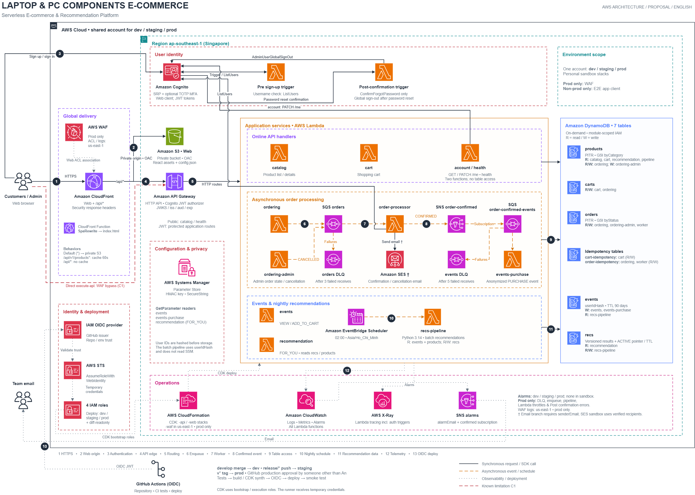

# Black Magic: a PC parts store with product recommendations, serverless on AWS

Team shop-ai: Nguyễn Hiếu An (team lead), Nguyễn Minh Hoàng, Nguyễn Trọng Nhân. FCAJ program, OJT from 14/09/2026.

Source code: [github.com/hhieuann/shop-ai](https://github.com/hhieuann/shop-ai)

---

### 1. Summary

Small PC parts shops have nobody to advise "if you buy this, you also need that", so they lose cross-sell revenue. The team built **Black Magic**, a store whose recommendations learn from the shop's own purchase data, running **fully serverless on AWS**: no servers to look after, close to zero cost with few visitors, and automatic scaling when traffic grows.

The system covers the full shopping flow (browsing, cart, ordering, account, order administration), 3 kinds of recommendations (frequently bought together, for you, best sellers), security from the start, 3 environments dev, staging, prod, and automated deployment. Version `v1.0.0` went to prod on 23/11/2026. The estimated cost for real use is about **$24.86/month**.

### 2. Problem

- A customer buying a laptop usually needs a mouse and a bag; a graphics card often needs a bigger power supply. Customers do not know, small shops lack staff to advise, so cross-sell orders are lost.
- Big marketplaces have recommendation engines, small shops do not: running servers and a recommender costs money and needs an operator.
- Small shops have low, uneven traffic. A server running 24/7 sits idle most of the time but still costs money.

### 3. Solution

A web store built on pay-per-use AWS services, with recommendations recomputed every night from the shop's own data.

**What users can do:**
- Customers: browse and search by category, add to cart (even before signing in), order with cash on delivery (COD), view and cancel orders, receive confirmation emails; manage their account (change username, change password, forgot password).
- Recommendations: "Frequently bought together" on product pages, "For you" based on each customer's history, "Best sellers" when there is not enough data.
- Admin: view orders by status, move orders to shipping and delivered, cancel orders (stock is restored).

**Recommender:** following the mentor's feedback (01/10/2026), the team **does not use Amazon Personalize** and builds its own model on Lambda and DynamoDB ([ADR-0016](https://github.com/hhieuann/shop-ai/blob/develop/docs/adr/0016-tu-xay-mo-hinh-goi-y.md)), so every step can be understood and explained. Each night a Python job computes:
- frequently bought together with association rules (counting items often bought together);
- for you with item-based collaborative filtering;
- best sellers as the fallback.

Results are only switched on after passing a quality gate; behaviour data hashes user IDs (HMAC) and expires after 90 days.

**Out of scope** (future work): online payment, part compatibility checks, complex inventory, returns, a mobile app, a shopping assistant using Amazon Bedrock.

### 4. Architecture

Everything runs in Singapore (`ap-southeast-1`), except the CloudFront AWS WAF in `us-east-1`.

The first draft of the diagram was made with AI assistance; the team checked every component, arrow and table read/write permission against the CDK code and corrected it.

| Need | AWS service | Why |
|---|---|---|
| Single entry point, static web | Amazon CloudFront, Amazon S3 (OAC) | Close to users, caches the product API; only CloudFront can read S3 |
| Block bad traffic (prod only) | AWS WAF | IP reputation list, rate limits, AWS common rule set |
| Sign-in, roles | Amazon Cognito | No self-stored passwords; the API checks JWTs |
| API | Amazon API Gateway (HTTP API) | Cheap, built-in JWT check |
| Business logic | AWS Lambda (one function per module) | Pay per invocation, scales automatically |
| Data | Amazon DynamoDB (on-demand, PITR) | Serverless, one table per module, point-in-time recovery |
| Asynchronous ordering | Amazon SQS (with DLQ), Amazon SNS | Ordering answers fast, processing happens later, failures do not lose orders |
| Email | Amazon SES | Order confirmation and cancellation emails |
| Nightly recommendation job | Amazon EventBridge Scheduler, Python Lambda | Runs at 02:00, no server needed |
| Secrets | AWS Systems Manager Parameter Store | HMAC key for behaviour data |
| Monitoring | Amazon CloudWatch, AWS X-Ray | Alarms by email, each with a runbook |
| Infrastructure, deployment | AWS CDK, GitHub Actions (OIDC) | Infrastructure as code; deploys without access keys |

**Three main flows:**
1. **Browsing:** CloudFront → API Gateway → catalog Lambda, recommendation Lambda (reads precomputed recommendations) and events Lambda (records views and add-to-cart).
2. **Ordering:** the ordering Lambda checks prices, decrements stock, removes items from the cart and writes the order in **one DynamoDB transaction**, then sends to SQS. A worker confirms the order, sends the SES email and publishes to SNS to record the purchase for recommendations. After 3 failures the message goes to the DLQ.
3. **Nightly recommendations:** EventBridge Scheduler invokes a Python Lambda that reads the events and products tables, computes the 3 kinds of recommendations and switches to the new version if it passes the gate.

### 5. Security

- A single entry point through CloudFront; prod has a WAF blocking with the AWS common rule set (checked: queries with `<script>` or `../etc/passwd` get 403).
- Security headers at CloudFront (CSP, HSTS, X-Frame-Options…); OWASP ZAP scan of dev: 0 FAIL.
- Least-privilege IAM for every Lambda; cdk-nag checks on every synth.
- Deploys from GitHub Actions through OIDC, no long-lived access keys.
- Resetting or changing a password revokes all old sessions (Cognito does not do this by itself).
- A threat model with 14 entries for accounts plus ordering, events and infrastructure; each entry has a mitigation and a status.

### 6. Plan and progress

Two-week sprints, git-flow (`develop`, `release/*`, `main`); every PR has CI (lint, tests, build, cdk-nag, security scans) and a reviewer.

| Milestone | Date | Content |
|---|---|---|
| Kick-off | 14/09–30/09/2026 | Problem, product category, architecture; account, budgets; CDK skeleton, CI/CD |
| Recommender change | 01/10/2026 | Dropped Amazon Personalize, built our own model (ADR-0016) |
| `v0.1.0` | 22/10/2026 | Browsing, search, accounts, cart; CloudFront, monitoring, E2E |
| `v0.2.0` | 05/11/2026 | Asynchronous ordering, SES email, event tracking, nightly recommendations, recommendation blocks on the web |
| `v1.0.0-rc.1` | 11/11/2026 | Prod WAF, admin order status, new product page, performance measurements, recovery drill |
| `v1.0.0` | 23/11/2026 | Account page, forgot/change password, admin cancellation; prod WAF blocking |
| Report submission | about 29/11/2026 | Workshop, blogs, demo video |

**Roles:**

| Member | Main responsibilities |
|---|---|
| Nguyễn Hiếu An | Team lead; CDK infrastructure, CI/CD, security, monitoring, cost; recommendation API; release coordination |
| Nguyễn Minh Hoàng | Web (React), ordering, cart, account, admin, two-factor authentication |
| Nguyễn Trọng Nhân | Data and the recommendation pipeline, threat model, WAF, recommendation poisoning experiment |

### 7. Cost

AWS Pricing Calculator estimate for a small shop running for real for 1 month (about 1,000 visits/day, 300 orders, 2,000 signed-in users): **$24.86/month** ([estimate](https://calculator.aws/#/estimate?id=0798eb584d82c280a557b96fbf3c8fbe695a6ca0)). Details in chapter 5.2.

| Service | USD/month |
|---|---|
| AWS WAF | 10.63 |
| Amazon CloudFront | 7.32 (actually $0 within the Free Tier, which the Calculator does not subtract) |
| Amazon CloudWatch | 3.21 |
| AWS X-Ray | 2.34 |
| DynamoDB, API Gateway, SES, S3, Cognito, Lambda, SQS, SNS, Scheduler | 1.36 |
| **Total** | **24.86** |

The real bill for 01–15/11/2026 (all 3 environments) matches the estimate: WAF is almost the whole cost, serverless services are close to $0. The account has 3 budget alerts at $5, $10 and $20.

### 8. Risks and mitigations

| Risk | Level | Mitigation |
|---|---|---|
| Unexpected AWS bill | Medium | 3 budget alerts; no NAT, EC2 or RDS; remove unused environments; remove the WAF after submission |
| Poor recommendations with little data | Medium | Quality gate; best-seller fallback; synthetic data based on personas |
| Attackers spamming events to push recommendations | Low | WAF rate limits; the experiment showed only 0.3–2% weight shift |
| Data loss from accidental deletion | Low | PITR; recovery drill done on staging |
| Email only reaches verified addresses | Low | SES still in sandbox, listed as a known limitation; orders are processed normally |
| Missing deadlines with a small team | Medium | Many small releases, a checklist for each, cross acceptance testing (testers are not authors) |

### 9. Results

| Metric | Target | Result |
|---|---|---|
| Mobile page performance (Lighthouse) | ≥ 90 | 94–99 |
| Read API p95 (k6, 200 virtual users) | ≤ 300 ms | 108 ms, 0 errors |
| Ordering p95 | ≤ 800 ms | 269 ms |
| Data recovery (PITR) | lose at most 5 minutes, recover within 1 hour | met, new table ready in 3–10 minutes |
| `v1.0.0` acceptance on staging | all cases pass | 8/8 passed |

`v1.0.0` has run on prod since 23/11/2026, with automated deploy and smoke tests green.
