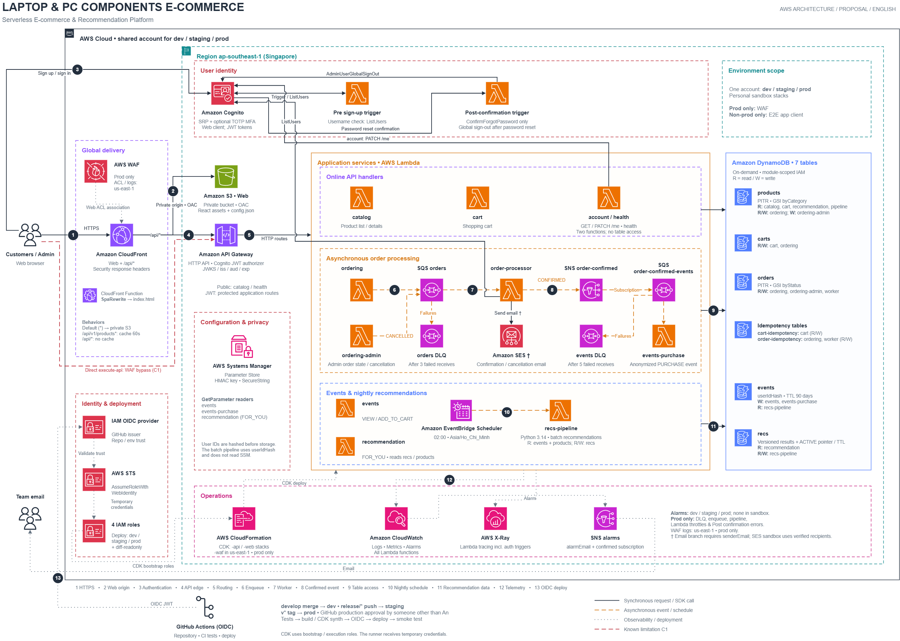

# Black Magic: web bán linh kiện máy tính có gợi ý sản phẩm, chạy serverless trên AWS

Nhóm shop-ai: Nguyễn Hiếu An (trưởng nhóm), Nguyễn Minh Hoàng, Nguyễn Trọng Nhân. Chương trình FCAJ, OJT từ 14/09/2026.

Mã nguồn: [github.com/hhieuann/shop-ai](https://github.com/hhieuann/shop-ai)

---

### 1. Tóm tắt

Shop nhỏ bán linh kiện máy tính không có người tư vấn "mua món này thì cần thêm gì", nên mất doanh thu bán kèm. Nhóm xây **Black Magic**, web bán hàng có gợi ý sản phẩm học từ chính dữ liệu mua hàng của shop, chạy **hoàn toàn serverless trên AWS**: không có máy chủ phải trông, ít khách thì chi phí gần bằng 0, đông khách thì tự mở rộng.

Hệ thống có đủ luồng mua bán (xem hàng, giỏ, đặt hàng, tài khoản, quản trị đơn), gợi ý 3 loại (thường mua kèm, dành cho bạn, bán chạy), bảo mật từ đầu, 3 môi trường dev, staging, prod và triển khai tự động. Bản `v1.0.0` lên prod ngày 23/11/2026. Chi phí ước tính khi chạy thật khoảng **$24,86/tháng**.

### 2. Vấn đề

- Khách mua laptop thường cần thêm chuột, túi; mua card đồ hoạ thường phải nâng nguồn. Khách không biết, shop nhỏ không đủ người tư vấn, nên mất đơn bán kèm.
- Các sàn lớn có hệ gợi ý, shop nhỏ thì không: tự dựng máy chủ và hệ gợi ý tốn tiền, cần người vận hành.
- Lưu lượng của shop nhỏ thấp và không đều. Thuê máy chủ chạy 24/7 thì phần lớn thời gian máy ngồi không mà vẫn tốn tiền.

### 3. Giải pháp

Web bán hàng chạy trên các dịch vụ AWS tính tiền theo lượt dùng, kèm hệ gợi ý tự tính lại mỗi đêm từ dữ liệu của shop.

**Người dùng làm được gì:**
- Khách: xem và tìm sản phẩm theo danh mục, thêm vào giỏ (kể cả khi chưa đăng nhập), đặt hàng thanh toán khi nhận (COD), xem và huỷ đơn, nhận email xác nhận; quản lý tài khoản (đổi username, đổi mật khẩu, quên mật khẩu).
- Gợi ý: "Thường mua kèm" ở trang sản phẩm, "Dành cho bạn" theo lịch sử của từng khách, "Bán chạy" khi chưa đủ dữ liệu.
- Admin: xem đơn theo trạng thái, chuyển đơn sang đang giao, đã giao, huỷ đơn (hoàn kho).

**Hệ gợi ý:** theo góp ý của mentor (01/10/2026), nhóm **không dùng Amazon Personalize** mà tự xây mô hình trên Lambda và DynamoDB ([ADR-0016](https://github.com/hhieuann/shop-ai/blob/develop/docs/adr/0016-tu-xay-mo-hinh-goi-y.md)), để hiểu và giải thích được từng bước. Mỗi đêm một job Python tính:
- thường mua kèm bằng luật kết hợp (đếm các món hay được mua cùng nhau);
- dành cho bạn bằng lọc cộng tác theo sản phẩm (item-based collaborative filtering);
- bán chạy làm phương án dự phòng.

Kết quả chỉ được bật khi qua ngưỡng chất lượng; dữ liệu hành vi băm mã người dùng (HMAC) và tự xoá sau 90 ngày.

**Phạm vi không làm** (hướng mở rộng): thanh toán online, kiểm tra tương thích linh kiện, quản lý kho phức tạp, đổi trả, app mobile, trợ lý mua sắm dùng Amazon Bedrock.

### 4. Kiến trúc

Toàn bộ ở vùng Singapore (`ap-southeast-1`), riêng AWS WAF của CloudFront ở `us-east-1`.

Sơ đồ dựng bản đầu với AI hỗ trợ, nhóm đối chiếu từng thành phần, mũi tên và quyền đọc/ghi bảng với code CDK rồi sửa lại.

| Nhu cầu | Dịch vụ AWS | Vì sao chọn |
|---|---|---|
| Cửa vào duy nhất, web tĩnh | Amazon CloudFront, Amazon S3 (OAC) | Gần người dùng, cache API sản phẩm; S3 chỉ CloudFront đọc được |
| Chặn truy cập xấu (chỉ prod) | AWS WAF | Danh sách IP xấu, giới hạn tần suất, bộ luật chung của AWS |
| Đăng nhập, phân quyền | Amazon Cognito | Không tự lưu mật khẩu; API kiểm JWT |
| API | Amazon API Gateway (HTTP API) | Rẻ, kiểm JWT sẵn |
| Xử lý nghiệp vụ | AWS Lambda (mỗi module một hàm) | Trả tiền theo lượt chạy, tự mở rộng |
| Lưu dữ liệu | Amazon DynamoDB (on-demand, PITR) | Không máy chủ, mỗi module một bảng, khôi phục theo thời điểm |
| Đặt hàng bất đồng bộ | Amazon SQS (kèm DLQ), Amazon SNS | Đặt hàng trả lời nhanh, xử lý sau, lỗi không mất đơn |
| Email | Amazon SES | Email xác nhận, huỷ đơn |
| Job gợi ý mỗi đêm | Amazon EventBridge Scheduler, Lambda Python | Chạy lúc 02:00, không cần máy chủ |
| Khoá bí mật | AWS Systems Manager Parameter Store | Khoá HMAC cho dữ liệu hành vi |
| Giám sát | Amazon CloudWatch, AWS X-Ray | Alarm báo email, mỗi alarm có runbook |
| Hạ tầng, triển khai | AWS CDK, GitHub Actions (OIDC) | Hạ tầng bằng code; deploy không cần access key |

**Ba luồng chính:**
1. **Xem hàng:** CloudFront → API Gateway → Lambda catalog, recommendation (đọc gợi ý đã tính sẵn) và events (ghi lượt xem, thêm giỏ).
2. **Đặt hàng:** Lambda ordering kiểm giá, trừ kho, bỏ món khỏi giỏ và ghi đơn trong **một giao dịch DynamoDB**, rồi gửi SQS. Worker xác nhận đơn, gửi email SES, phát SNS để ghi lượt mua cho gợi ý. Lỗi 3 lần thì vào DLQ.
3. **Gợi ý mỗi đêm:** EventBridge Scheduler gọi Lambda Python đọc bảng sự kiện và sản phẩm, tính 3 loại gợi ý, đạt ngưỡng thì đổi sang bản mới.

### 5. Bảo mật

- Một cửa vào duy nhất qua CloudFront; prod có WAF chặn bằng bộ luật chung của AWS (đã kiểm: query có `<script>` hay `../etc/passwd` bị 403).
- Header bảo mật ở CloudFront (CSP, HSTS, X-Frame-Options…); quét OWASP ZAP vào dev: 0 FAIL.
- IAM quyền tối thiểu cho từng Lambda; cdk-nag kiểm mỗi lần synth.
- Deploy bằng GitHub Actions qua OIDC, không có access key dài hạn.
- Đặt lại hoặc đổi mật khẩu thì thu hồi mọi phiên cũ (Cognito không tự làm việc này).
- Threat model 14 mục cho phần tài khoản cùng các phần đặt hàng, sự kiện, hạ tầng; mỗi mục có cách xử lý và trạng thái.

### 6. Kế hoạch và tiến độ

Làm theo sprint 2 tuần, git-flow (`develop`, `release/*`, `main`), mỗi PR có CI (lint, test, build, cdk-nag, quét bảo mật) và người review.

| Mốc | Ngày | Nội dung |
|---|---|---|
| Khởi động | 14/09–30/09/2026 | Chốt bài toán, ngành hàng, kiến trúc; tài khoản, budget; CDK khung, CI/CD |
| Đổi hướng gợi ý | 01/10/2026 | Bỏ Amazon Personalize, tự xây mô hình (ADR-0016) |
| `v0.1.0` | 22/10/2026 | Xem hàng, tìm kiếm, tài khoản, giỏ hàng; CloudFront, giám sát, E2E |
| `v0.2.0` | 05/11/2026 | Đặt hàng bất đồng bộ, email SES, ghi sự kiện, gợi ý mỗi đêm, khối gợi ý trên web |
| `v1.0.0-rc.1` | 11/11/2026 | WAF prod, admin chuyển trạng thái đơn, trang chi tiết mới, đo hiệu năng, diễn tập khôi phục |
| `v1.0.0` | 23/11/2026 | Trang tài khoản, quên/đổi mật khẩu, admin huỷ đơn; WAF prod chặn |
| Nộp báo cáo | khoảng 29/11/2026 | Workshop, blog, video demo |

**Phân công:**

| Thành viên | Phụ trách chính |
|---|---|
| Nguyễn Hiếu An | Trưởng nhóm; hạ tầng CDK, CI/CD, bảo mật, giám sát, chi phí; API gợi ý; điều phối phát hành |
| Nguyễn Minh Hoàng | Web (React), đặt hàng, giỏ, tài khoản, admin, xác thực hai lớp |
| Nguyễn Trọng Nhân | Dữ liệu và pipeline gợi ý, threat model, WAF, thí nghiệm đầu độc gợi ý |

### 7. Chi phí

Ước tính trên AWS Pricing Calculator cho shop nhỏ chạy thật 1 tháng (khoảng 1.000 lượt truy cập/ngày, 300 đơn, 2.000 người dùng đăng nhập): **$24,86/tháng** ([bản ước tính](https://calculator.aws/#/estimate?id=0798eb584d82c280a557b96fbf3c8fbe695a6ca0)). Chi tiết ở chương 5.2.

| Dịch vụ | USD/tháng |
|---|---|
| AWS WAF | 10,63 |
| Amazon CloudFront | 7,32 (thực tế $0 vì nằm trong Free Tier, Calculator không tự trừ) |
| Amazon CloudWatch | 3,21 |
| AWS X-Ray | 2,34 |
| DynamoDB, API Gateway, SES, S3, Cognito, Lambda, SQS, SNS, Scheduler | 1,36 |
| **Tổng** | **24,86** |

Hoá đơn thật 01–15/11/2026 (cả 3 môi trường) khớp ước tính: WAF gần như là toàn bộ chi phí, các dịch vụ serverless gần bằng $0. Tài khoản có 3 budget cảnh báo $5, $10, $20.

### 8. Rủi ro và cách giảm

| Rủi ro | Mức | Cách giảm |
|---|---|---|
| Hoá đơn AWS bất ngờ | Vừa | 3 budget cảnh báo; không dùng NAT, EC2, RDS; xoá môi trường không dùng; gỡ WAF sau khi nộp |
| Gợi ý kém khi ít dữ liệu | Vừa | Ngưỡng chất lượng; dự phòng bằng "bán chạy"; dữ liệu giả lập theo persona |
| Kẻ xấu spam sự kiện để đẩy gợi ý | Thấp | Giới hạn tần suất ở WAF; thí nghiệm cho thấy chỉ đẩy được 0,3–2% trọng số |
| Mất dữ liệu do xoá nhầm | Thấp | PITR; đã diễn tập khôi phục trên staging |
| Email chỉ gửi được tới địa chỉ đã xác minh | Thấp | SES còn sandbox, ghi rõ ở giới hạn đã biết; đơn vẫn xử lý bình thường |
| Trễ hạn vì nhóm nhỏ | Vừa | Phát hành nhiều mốc nhỏ, checklist mỗi đợt, nghiệm thu chéo (người test không phải người viết) |

### 9. Kết quả đạt được

| Chỉ số | Mục tiêu | Kết quả |
|---|---|---|
| Tốc độ trang trên điện thoại (Lighthouse) | ≥ 90 | 94–99 |
| API đọc, p95 (k6, 200 người dùng ảo) | ≤ 300 ms | 108 ms, 0 lỗi |
| Đặt hàng, p95 | ≤ 800 ms | 269 ms |
| Khôi phục dữ liệu (PITR) | mất tối đa 5 phút, khôi phục trong 1 giờ | đạt, bảng mới sẵn sàng sau 3–10 phút |
| Nghiệm thu `v1.0.0` trên staging | đạt mọi ca | 8/8 ca đạt |

Bản `v1.0.0` chạy trên prod từ 23/11/2026, deploy và smoke test tự động xanh.
