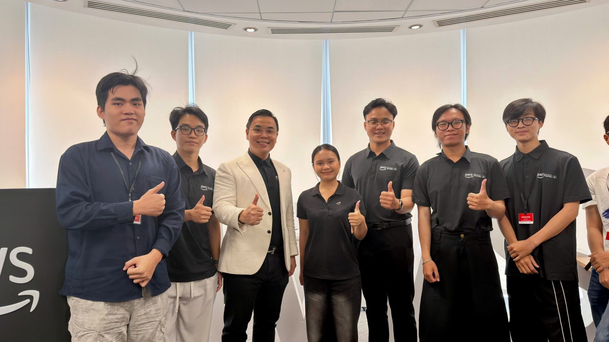
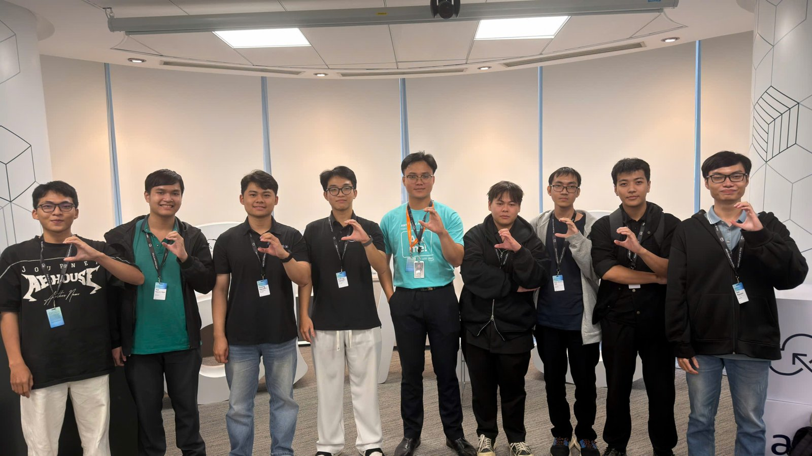
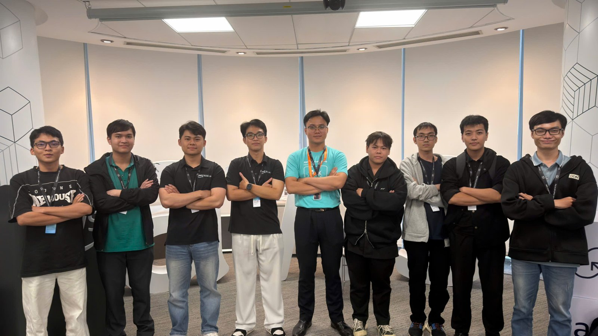
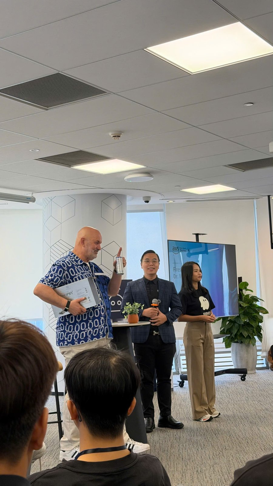
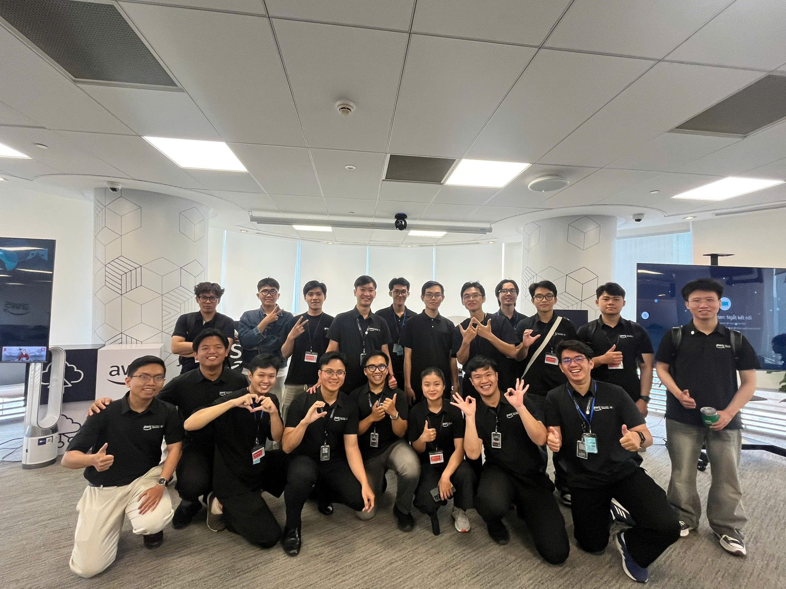

During the internship I attended 3 events, all held at the AWS Vietnam office in the Bitexco tower (Ho Chi Minh City).

| # | Event | Date | Role |
|---|---|---|---|
| 1 | FCAJ Buildrathon 2026 Kickoff and the talkshow "The Thinking Behind Building The Bot" (CMC Global) | 26/09/2026 | Attendee |
| 2 | AWS Cloud & AI Day 2026 | 29/09/2026 | Attendee |
| 3 | Fireside Chat with Dr. Werner Vogels | 02/10/2026 | Attendee |

---

### Event 1: FCAJ Buildrathon 2026 Kickoff and the talkshow "The Thinking Behind Building The Bot"

- **Date:** 26/09/2026
- **Location:** AWS Vietnam office, Bitexco, Ho Chi Minh City
- **Role:** attendee
- **Partner:** CMC Global

**Main content:**
- An introduction to the First Cloud AI Journey (FCAJ) program: why it exists, the internship milestones and how teams build their final projects.
- The talkshow "The Thinking Behind Building The Bot" with CMC Global:
  - **Practical AI Agent thinking:** from laying the architecture foundation for a bot to optimizing AI Agents in an enterprise setting.
  - **Solving the challenges:** dissecting hard test cases live with the experts, learning through real problems.
  - **Career connections:** 1-1 conversations with the CMC Global HR team at the event.

**Reflections and lessons:**
- This was one of the first times I clearly understood what FCAJ is and why it was created: not only learning AWS services but building a real product as a team, with a company-like process.
- The talkshow showed me that building a bot or an AI Agent does not start with calling a model but with the architecture: where the data comes from, how input is controlled, how it behaves on failure. I carried this into how our team designed shop-ai's recommendations: behaviour data is hashed before storage, and results are only switched on after passing a quality gate.
- Talking directly with HR helped me understand what companies expect from a new cloud engineer.

---

### Event 2: AWS Cloud & AI Day 2026

- **Date:** 29/09/2026
- **Location:** AWS Vietnam office, Bitexco, Ho Chi Minh City
- **Role:** attendee

**Main content:**
- The biggest AWS event I attended during the internship, with discussions and live, hands-on breakdowns of real cloud and AI problems.
- A live link with the Hanoi venue, so attendees in Ho Chi Minh City could follow the Hanoi sessions as well.
- A meeting place for the Builder community to share experience learning and building on AWS.

**Reflections and lessons:**
- The practical breakdowns showed me how working engineers choose services: they always start from the problem, the cost and the operations, not from the technology. Our team applied this when choosing a serverless architecture for shop-ai and estimating costs with the AWS Pricing Calculator from the start.
- Meeting other Builders gave me motivation, and I learned how other teams split work, write documentation and review code.
- I realized the community is part of learning: ask in the right place, and share back what you have built (for example through blog posts in the AWS Study Group).

---

### Event 3: Fireside Chat with Dr. Werner Vogels

- **Date:** 02/10/2026
- **Location:** AWS Vietnam office, Bitexco, Ho Chi Minh City
- **Role:** attendee
- **Speaker:** Dr. Werner Vogels, CTO of Amazon

**Main content** (also checked against the summary [The Invariable Lessons of Tech and Humanity](https://builder.aws.com/content/3KBSLeKsdkk6uMUPq7d9Xxa5jbS/the-invariable-lessons-of-tech-and-humanity-key-takeaways-from-amazon-cto-werner-vogels) by Le Vu Xuan An on AWS Builder Center):
- **Build it yourself when off-the-shelf software cannot scale:** the story of Amazon's database outage at peak season, which led to the technology behind DynamoDB. Most real access is key-value reads and writes that do not need a relational database.
- **Measure tail latency:** the median hides the worst customer experience; measure at very high percentiles such as P99.9.
- **"Everything fails all the time":** design so that losing one or two data centers does not stop the service, and rehearse for real with GameDays so recovery is automatic, not manual.
- **Pay-as-you-go:** puts the burden on the provider, who must keep serving well to keep customers.
- **The "Renaissance Developer" in the AI era:** curiosity and continuous learning, systems thinking, ownership of the outcome, broad knowledge, good communication.
- **Ownership stays with the engineer:** AI writing code is like an imprecise natural-language compiler, so production bugs, security flaws and architecture remain the engineer's job; humans keep judgment, creativity and empathy.
- **Avoid complacency:** the talk closed with a reminder not to do something just because "we've always done it this way".

**Reflections and lessons:**
- Hearing Amazon's CTO in person was the most memorable experience of the internship. His points are very close to what our team does:
  - **Design for failure:** shop-ai orders go through an SQS queue with a DLQ, so a failing worker does not lose orders.
  - **Rehearse for real:** the team rehearsed restoring a DynamoDB table with PITR on staging, and deliberately broke the session-revoke trigger to see how the system reacts.
  - **Measure the tail:** the team measures p95 in k6 load tests instead of just the average; after this talk I understood why large systems go even higher.
  - **Own AI-written code:** the team uses AI assistance, but every change goes through review, tests and a check against the real code before merging.
- The "Renaissance Developer" idea made me rethink how I learn: not just one service, but how systems fit together and how to talk with business people about cost and risk.
