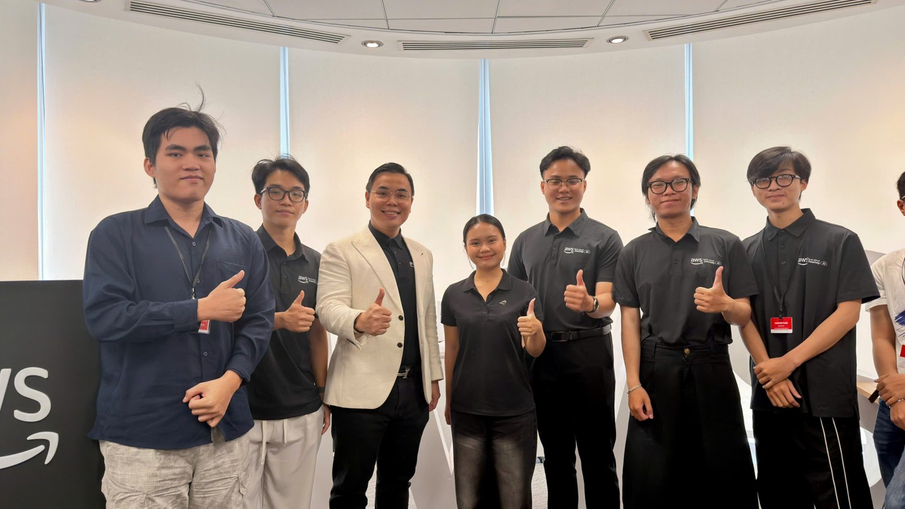
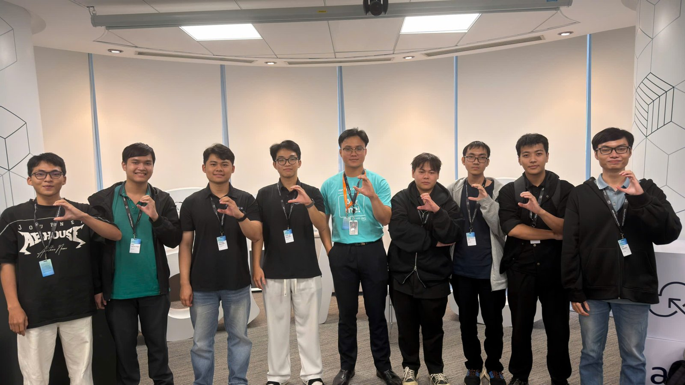
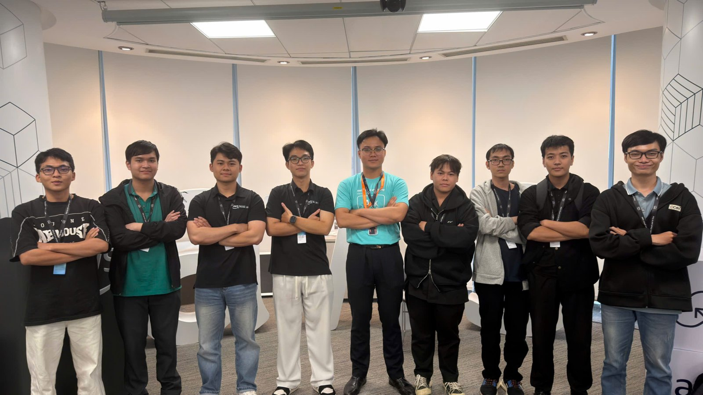
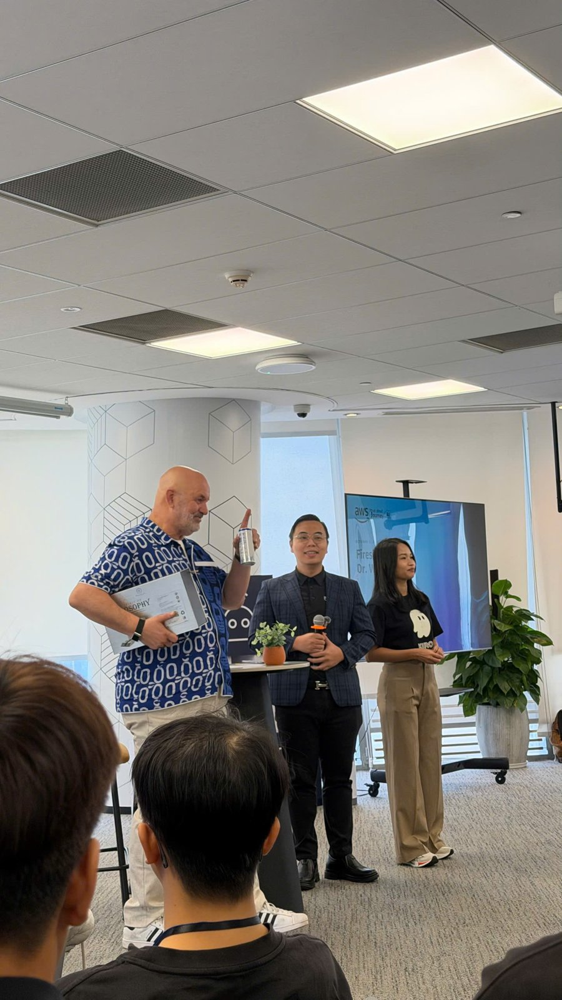
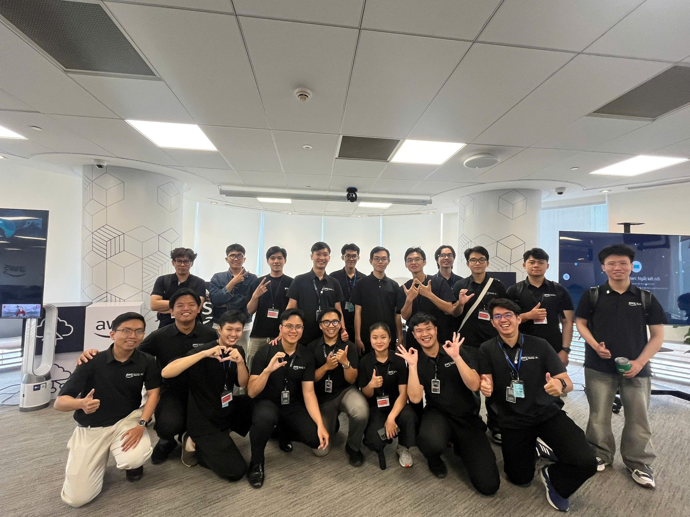

Trong thời gian thực tập, mình tham gia 3 sự kiện, đều tổ chức tại văn phòng AWS Việt Nam, tòa nhà Bitexco (TP.HCM).

| # | Sự kiện | Ngày | Vai trò |
|---|---|---|---|
| 1 | Kickoff FCAJ Buildrathon 2026 và Talkshow "The Thinking Behind Building The Bot" (CMC Global) | 26/09/2026 | Người tham dự |
| 2 | AWS Cloud & AI Day 2026 | 29/09/2026 | Người tham dự |
| 3 | Fireside Chat with Dr. Werner Vogels | 02/10/2026 | Người tham dự |

---

### Sự kiện 1: Kickoff FCAJ Buildrathon 2026 và Talkshow "The Thinking Behind Building The Bot"

- **Thời gian:** 26/09/2026
- **Địa điểm:** văn phòng AWS Việt Nam, Bitexco, TP.HCM
- **Vai trò:** người tham dự
- **Đơn vị đồng hành:** CMC Global

**Nội dung chính:**
- Giới thiệu chương trình First Cloud AI Journey (FCAJ): chương trình mở ra để làm gì, các mốc trong kỳ thực tập và cách các nhóm làm dự án cuối kỳ.
- Talkshow "The Thinking Behind Building The Bot" cùng CMC Global:
  - **Tư duy AI Agent thực chiến:** từ cách đặt nền móng kiến trúc cho một con bot đến bài toán tối ưu AI Agent trong môi trường doanh nghiệp.
  - **Giải mã thử thách:** cùng các chuyên gia mổ xẻ trực tiếp những bài test khó, học bằng va chạm thật.
  - **Kết nối nghề nghiệp:** gặp và trao đổi 1-1 với đội ngũ HR của CMC Global ngay tại sự kiện.

**Cảm nghĩ và bài học:**
- Đây là một trong những lần đầu mình hiểu rõ FCAJ là gì và vì sao chương trình được mở ra: không chỉ học dịch vụ AWS mà còn làm một sản phẩm thật theo nhóm, có quy trình như ở công ty.
- Phần talkshow cho mình thấy làm bot hay AI Agent không bắt đầu từ việc gọi một mô hình, mà từ kiến trúc: dữ liệu lấy ở đâu, kiểm soát đầu vào ra sao, chạy thế nào khi lỗi. Ý này mình mang vào cách nhóm thiết kế phần gợi ý của shop-ai: dữ liệu hành vi được băm trước khi lưu, kết quả chỉ được bật khi qua ngưỡng chất lượng.
- Được nói chuyện trực tiếp với HR giúp mình biết doanh nghiệp đang cần gì ở một kỹ sư cloud mới ra trường.

---

### Sự kiện 2: AWS Cloud & AI Day 2026

- **Thời gian:** 29/09/2026
- **Địa điểm:** văn phòng AWS Việt Nam, Bitexco, TP.HCM
- **Vai trò:** người tham dự

**Nội dung chính:**
- Sự kiện lớn nhất của AWS mà mình tham gia trong kỳ thực tập, gồm các phiên thảo luận và phần mổ xẻ bài toán thực chiến ngay tại chỗ về cloud và AI.
- Kết nối liền mạch với điểm cầu Hà Nội, nên người tham dự ở TP.HCM cũng theo được các phiên ở Hà Nội.
- Là nơi giao lưu của cộng đồng Builder, chia sẻ kinh nghiệm học và làm trên AWS.

**Cảm nghĩ và bài học:**
- Nghe các phần mổ xẻ thực chiến giúp mình thấy cách người đi làm chọn dịch vụ: luôn bắt đầu từ bài toán, chi phí và vận hành chứ không bắt đầu từ công nghệ. Nhóm mình áp dụng khi chọn kiến trúc serverless cho shop-ai và tính chi phí bằng AWS Pricing Calculator ngay từ đầu.
- Được gặp và nói chuyện với các bạn Builder khác cho mình thêm động lực, và học được cách các nhóm khác chia việc, viết tài liệu, review code.
- Mình nhận ra cộng đồng là một phần của việc học: hỏi đúng chỗ, chia sẻ lại những gì mình làm được (ví dụ qua các bài blog trên nhóm AWS Study Group).

---

### Sự kiện 3: Fireside Chat with Dr. Werner Vogels

- **Thời gian:** 02/10/2026
- **Địa điểm:** văn phòng AWS Việt Nam, Bitexco, TP.HCM
- **Vai trò:** người tham dự
- **Diễn giả:** Dr. Werner Vogels, CTO của Amazon

**Nội dung chính** (đối chiếu thêm với bài tổng hợp [The Invariable Lessons of Tech and Humanity](https://builder.aws.com/content/3KBSLeKsdkk6uMUPq7d9Xxa5jbS/the-invariable-lessons-of-tech-and-humanity-key-takeaways-from-amazon-cto-werner-vogels) của Lê Vũ Xuân An trên AWS Builder Center):
- **Tự xây khi phần mềm có sẵn không chịu nổi quy mô:** câu chuyện cơ sở dữ liệu của Amazon gặp sự cố đúng mùa cao điểm, từ đó dẫn tới công nghệ phía sau DynamoDB. Phần lớn truy cập thật ra chỉ là đọc ghi theo khoá, không cần cơ sở dữ liệu quan hệ.
- **Đo độ trễ ở phần đuôi:** nhìn số trung vị thì không thấy trải nghiệm tệ nhất của khách; phải đo ở mức rất cao như P99.9.
- **"Everything fails all the time":** thiết kế để mất một hai trung tâm dữ liệu vẫn chạy, và diễn tập thật bằng GameDays để việc khôi phục là tự động chứ không phải làm tay.
- **Trả tiền theo mức dùng:** đẩy trách nhiệm về phía nhà cung cấp, vì muốn giữ khách thì phải phục vụ tốt liên tục.
- **"Renaissance Developer" trong thời AI:** tò mò và học liên tục, tư duy hệ thống, chịu trách nhiệm đến kết quả cuối, kiến thức rộng, giao tiếp tốt.
- **Trách nhiệm vẫn là của kỹ sư:** AI viết code giống một trình biên dịch bằng ngôn ngữ tự nhiên nhưng không chính xác, nên lỗi trên production, lỗ hổng bảo mật và kiến trúc vẫn là việc của người kỹ sư; con người giữ phần phán đoán, sáng tạo và thấu cảm.
- **Đừng tự mãn:** buổi chia sẻ khép lại bằng lời nhắc đừng làm một việc chỉ vì "từ trước tới giờ vẫn làm vậy".

**Cảm nghĩ và bài học:**
- Được nghe trực tiếp CTO của Amazon là trải nghiệm đáng nhớ nhất trong kỳ thực tập. Những ý ông nói rất gần với những gì nhóm đang làm:
  - **Thiết kế để chịu lỗi:** đơn hàng của shop-ai đi qua hàng đợi SQS có DLQ, nên worker lỗi cũng không mất đơn.
  - **Diễn tập thật:** nhóm đã diễn tập khôi phục bảng DynamoDB bằng PITR trên staging, và cố tình làm hỏng trigger thu hồi phiên để xem hệ thống phản ứng ra sao.
  - **Đo phần đuôi:** nhóm đo p95 khi load test bằng k6 thay vì chỉ nhìn trung bình; sau buổi này mình hiểu vì sao các hệ thống lớn còn đo ở mức cao hơn nữa.
  - **Chịu trách nhiệm với code do AI viết:** nhóm có dùng AI hỗ trợ, nhưng mọi thay đổi đều phải qua review, test và đối chiếu với code thật trước khi merge.
- Ý "Renaissance Developer" làm mình nghĩ lại cách học: không chỉ học một dịch vụ mà học cả cách hệ thống ghép lại, cách nói chuyện với người làm business về chi phí và rủi ro.
