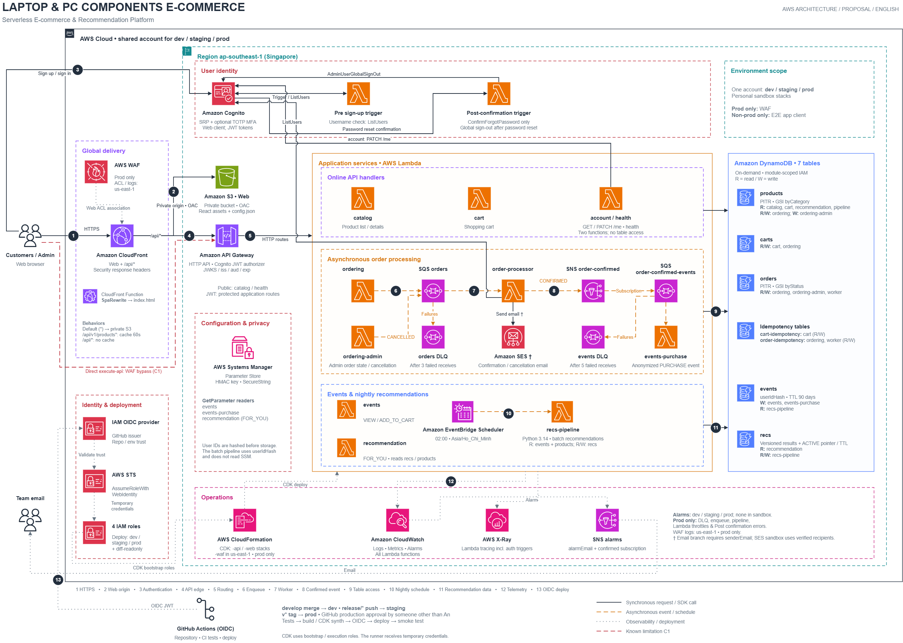

This chapter introduces the problem, the architecture and the AWS services of shop-ai before you start building. When you finish it you know what you are about to deploy, what each service does and why the team chose it.

#### Goals

- Understand the problem of a small shop selling laptops and PC parts, and why a serverless architecture fits.
- Read the architecture diagram: which services the data goes through in the 3 flows of browsing, ordering and nightly recommendations.
- Know why each service was chosen and which limitations the team accepted.

---

### 5.1.1. The problem

A small shop selling laptops and PC parts has nobody to advise "if you buy this, you also need that": a laptop buyer usually needs a mouse and a bag; a new graphics card often needs a bigger power supply. Customers do not know, so the shop loses cross-sell orders. The shop also has nobody to look after servers, and its traffic is low and uneven: a server running 24/7 sits idle most of the time but is still billed.

**Black Magic** (the shop-ai project) is a web store that solves this:

- **The full shopping flow:** browse and search products, a cart (also before signing in), cash-on-delivery ordering, viewing and cancelling orders, confirmation emails, an account page and an order administration page.
- **Recommendations from the shop's own data:** "Frequently bought together" on product pages, "For you" from each customer's history, "Best sellers" when there is not enough data. The model is built by the team and recomputed every night.
- **Fully serverless:** no servers to patch or monitor; close to $0 with few visitors, automatic scaling with many.

### 5.1.2. What you will do in this lab

| Chapter | You will |
|---|---|
| [5.2 Prerequisites](../5.2-prerequisite/) | Prepare the account, tools, CDK bootstrap, budget alerts and the HMAC key; know what the lab costs |
| [5.3 Deploying the Infrastructure](../5.3-infrastructure/) | Deploy all of shop-ai to your own sandbox with one CDK command, open the site and sign in |
| [5.4 Sales Flow](../5.4-salesflow/) | Orders that are never lost or duplicated: a DynamoDB transaction, `Idempotency-Key`, SQS, DLQ, SES email |
| [5.5 Recommendations and Data Security](../5.5-recommendations/) | Generate data and evaluate the model locally, run the recommendation pipeline on AWS, anonymize user data, run the recommendation poisoning experiment |
| [5.6 Testing and Operations](../5.6-testing/) | Trace an order with CloudWatch Logs Insights and X-Ray, read alarms and runbooks, handle a real DLQ incident; see the team's performance numbers |
| [5.7 Clean Up](../5.7-cleanup/) | Delete each stack, leftover log groups and keys, check Billing the next day |

The lab runs in **your own sandbox** (`shop-sbx-<name>`) and does not touch the team's environments. The sandbox has no WAF and no CloudWatch alarms, so it costs close to $0 (details in 5.2).

### 5.1.3. Architecture

The first draft of the diagram was made with AI assistance; the team checked every component, arrow and table read/write permission against the CDK code and corrected it. Everything runs in Singapore (`ap-southeast-1`), except the CloudFront AWS WAF in `us-east-1`. The dev, staging and prod environments share one account, and each lab user has their own sandbox.

**Browsing and sign-in (steps 1–5)**

1. The customer opens the site over HTTPS through **Amazon CloudFront**. On prod, **AWS WAF** filters requests first.
2. Static files come from a private **Amazon S3** bucket that only CloudFront can read (OAC). A CloudFront Function handles single-page routes; the product list is cached for 60 seconds.
3. The customer signs up and signs in directly with **Amazon Cognito**. A Pre sign-up trigger checks the username is unique; a Post confirmation trigger revokes all old sessions after a password reset.
4. Calls to `/api/*` go to **Amazon API Gateway** (HTTP API), which checks the Cognito JWT on routes that need sign-in.
5. API Gateway routes to **AWS Lambda**, one function per module: catalog, cart, account, ordering, ordering-admin, events, recommendation.

**Ordering (steps 6–9)**

6. The ordering Lambda checks prices, decrements stock, removes items from the cart and writes a `PENDING` order in **one DynamoDB transaction**, then sends the order to an **Amazon SQS** queue.
7. The order-processor worker confirms the order and sends the email through **Amazon SES**. After 3 failures the message goes to the orders DLQ.
8. The worker publishes `order-confirmed` to **Amazon SNS**; an SQS queue receives it so the events-purchase Lambda records an anonymized purchase (events DLQ after 5 failures).
9. Each Lambda reads and writes only the **Amazon DynamoDB** tables it needs (7 tables). Admin cancellation restores stock in the same transaction.

**Nightly recommendations (steps 10–11)**

10. At 02:00, **Amazon EventBridge Scheduler** invokes the recs-pipeline Lambda (Python), which reads the events and products tables, computes the 3 recommendation types, writes a new version to the `recs` table and only switches the `ACTIVE` pointer when the quality gate passes.
11. While browsing, the events Lambda records `VIEW` and `ADD_TO_CART` with the user ID hashed with HMAC (key in **SSM Parameter Store**); the recommendation Lambda just reads precomputed results, so pages stay fast.

**Operations (steps 12–13)**

12. **Amazon CloudWatch** collects logs, metrics and alarms; **AWS X-Ray** traces every Lambda; alarms send email through SNS.
13. **GitHub Actions** deploys with **AWS CDK** through OIDC, without access keys: a merge to `develop` goes to dev, a `release/*` branch to staging, a `v*` tag to prod after someone else approves.

### 5.1.4. AWS services and why they were chosen

| Service | Used for | Why |
|---|---|---|
| Amazon CloudFront, AWS WAF | Single entry point for web and API; WAF on prod only | One domain, caching close to users; WAF blocks bad IPs, rate-limits, applies the AWS common rule set (ADR-0006) |
| Amazon S3 | Static web (React) | Cheap, readable only by CloudFront through OAC |
| Amazon Cognito | Sign-up, sign-in, admin group | No self-stored passwords; issues JWTs for the API (ADR-0007) |
| Amazon API Gateway (HTTP API) | API routing, JWT check | Cheaper than REST API, built-in JWT authorizer (ADR-0007) |
| AWS Lambda | Business logic, worker, recommendation job | Pay per invocation, scales automatically; outside a VPC so there is no NAT Gateway cost (ADR-0005) |
| Amazon DynamoDB | Products, carts, orders, events, recommendations | On-demand, serverless, one table per module to limit permissions (ADR-0012); PITR for recovery |
| Amazon SQS, Amazon SNS | Asynchronous ordering, purchase events for recommendations | Ordering answers fast; a failing worker does not lose orders thanks to the DLQ |
| Amazon SES | Confirmation and cancellation emails | Sends email from Lambda, billed per message |
| Amazon EventBridge Scheduler | Runs the recommendation job at 02:00 | A schedule without servers |
| AWS Systems Manager Parameter Store | HMAC key | Encrypted secret, not in the code |
| Amazon CloudWatch, AWS X-Ray | Logs, metrics, alarms, traces | Monitoring and alerting, each alarm with a runbook |
| AWS CDK, GitHub Actions (OIDC) | Infrastructure as code, automated deployment | Rebuild a whole environment with one command; no long-lived access keys (ADR-0008) |

**Own recommendation model instead of Amazon Personalize:** following the mentor's feedback (01/10/2026), the team built its own model on Lambda and DynamoDB so every step can be understood and explained (ADR-0016). The pipeline uses association rules for "frequently bought together", item-based collaborative filtering for "for you", and best sellers as the fallback.

### 5.1.5. Known limitations

{}
The team accepted and documented these limitations; you will meet them again in later chapters:
- **Calling the `execute-api` URL** of API Gateway directly bypasses WAF (C1 on the diagram); stage throttling and JWT checks still apply.
- **SES is still in sandbox:** emails only reach verified addresses.
- **An old access token** keeps working until it expires (at most 1 hour) after sessions are revoked.
{}
