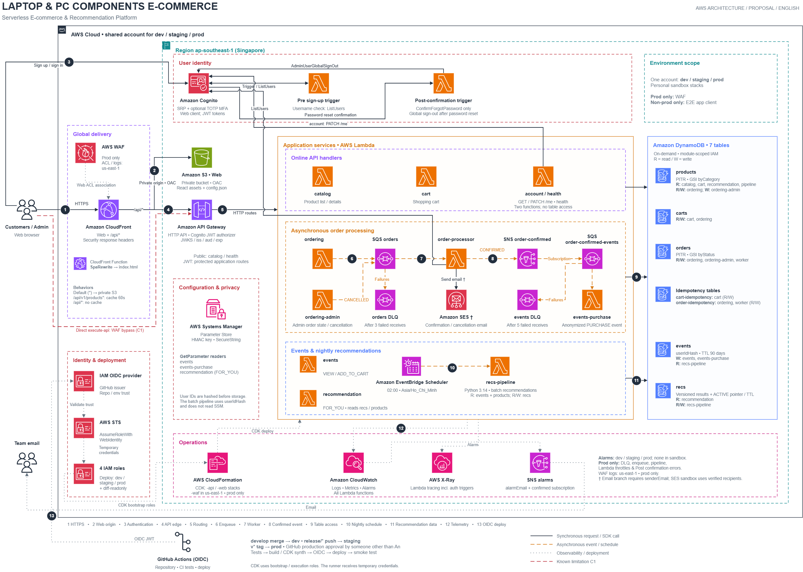

Chương này giới thiệu bài toán, kiến trúc và các dịch vụ AWS của shop-ai trước khi bắt tay vào làm. Đọc xong bạn biết mình sắp dựng gì, mỗi dịch vụ làm việc gì và vì sao nhóm chọn nó.

#### Mục tiêu

- Hiểu bài toán của một shop nhỏ bán laptop và linh kiện máy tính, và vì sao chọn kiến trúc serverless.
- Đọc được sơ đồ kiến trúc: dữ liệu đi qua những dịch vụ nào trong 3 luồng xem hàng, đặt hàng và gợi ý mỗi đêm.
- Biết lý do chọn từng dịch vụ và những giới hạn nhóm đã chấp nhận.

---

### 5.1.1. Bài toán

Shop nhỏ bán laptop và linh kiện máy tính không có người tư vấn "mua món này thì cần thêm gì": mua laptop thường cần thêm chuột, túi; mua card đồ hoạ thường phải nâng nguồn. Khách không biết, nên shop mất đơn bán kèm. Shop cũng không có người trông máy chủ, và lưu lượng thấp, không đều: thuê máy chủ chạy 24/7 thì phần lớn thời gian máy ngồi không mà vẫn tốn tiền.

**Black Magic** (dự án shop-ai) là web bán hàng giải bài toán đó:

- **Đủ luồng mua bán:** xem và tìm sản phẩm, giỏ hàng (kể cả khi chưa đăng nhập), đặt hàng thanh toán khi nhận, xem và huỷ đơn, email xác nhận, trang tài khoản, trang quản trị đơn.
- **Gợi ý từ dữ liệu của chính shop:** "Thường mua kèm" ở trang sản phẩm, "Dành cho bạn" theo lịch sử từng khách, "Bán chạy" khi chưa đủ dữ liệu. Mô hình do nhóm tự xây, tính lại mỗi đêm.
- **Hoàn toàn serverless:** không có máy chủ phải cập nhật hay theo dõi; ít khách thì chi phí gần bằng 0, đông khách thì tự mở rộng.

### 5.1.2. Sau lab này bạn làm được gì

| Chương | Bạn sẽ làm |
|---|---|
| [5.2 Chuẩn bị](../5.2-prerequisite/) | Chuẩn bị tài khoản, công cụ, CDK bootstrap, budget cảnh báo, khoá HMAC; biết lab tốn bao nhiêu |
| [5.3 Triển khai hạ tầng](../5.3-infrastructure/) | Deploy toàn bộ shop-ai lên sandbox của bạn bằng một lệnh CDK, mở web và đăng nhập |
| [5.4 Luồng bán hàng](../5.4-salesflow/) | Đặt hàng không mất, không trùng: giao dịch DynamoDB, `Idempotency-Key`, SQS, DLQ, email SES |
| [5.5 Gợi ý và bảo mật dữ liệu](../5.5-recommendations/) | Sinh dữ liệu và đánh giá mô hình trên máy, chạy pipeline gợi ý trên AWS, ẩn danh dữ liệu người dùng, thí nghiệm đầu độc gợi ý |
| [5.6 Kiểm thử và vận hành](../5.6-testing/) | Lần theo một đơn bằng CloudWatch Logs Insights và X-Ray, đọc alarm và runbook, xử lý một sự cố DLQ thật; xem số đo hiệu năng của nhóm |
| [5.7 Dọn dẹp](../5.7-cleanup/) | Xoá từng stack, log group và khoá còn sót, hôm sau kiểm tra Billing |

Lab chạy trên **sandbox riêng của bạn** (`shop-sbx-<tên>`), không đụng tới môi trường của nhóm. Sandbox không có WAF và CloudWatch alarm nên chi phí gần như $0 (chi tiết ở 5.2).

### 5.1.3. Kiến trúc

Sơ đồ dựng bản đầu với AI hỗ trợ, nhóm đối chiếu từng thành phần, mũi tên và quyền đọc/ghi bảng với code CDK rồi sửa lại. Toàn bộ ở vùng Singapore (`ap-southeast-1`), riêng AWS WAF của CloudFront ở `us-east-1`. Ba môi trường dev, staging, prod dùng chung một tài khoản, mỗi người làm lab có sandbox riêng.

**Xem hàng và đăng nhập (bước 1–5)**

1. Khách mở web qua **Amazon CloudFront** bằng HTTPS. Ở prod, **AWS WAF** lọc truy cập trước.
2. File tĩnh lấy từ bucket **Amazon S3** private, chỉ CloudFront đọc được (OAC). Một CloudFront Function lo đường dẫn của web một trang; danh sách sản phẩm được cache 60 giây.
3. Khách đăng ký, đăng nhập trực tiếp với **Amazon Cognito**. Trigger Pre sign-up kiểm username không trùng; trigger Post confirmation thu hồi mọi phiên cũ sau khi đặt lại mật khẩu.
4. Lệnh gọi `/api/*` tới **Amazon API Gateway** (HTTP API), kiểm token JWT của Cognito ở các route cần đăng nhập.
5. API Gateway chuyển tới **AWS Lambda**, mỗi module một hàm: catalog, cart, account, ordering, ordering-admin, events, recommendation.

**Đặt hàng (bước 6–9)**

6. Lambda ordering kiểm giá, trừ kho, bỏ món khỏi giỏ và ghi đơn `PENDING` trong **một giao dịch DynamoDB**, rồi gửi đơn vào hàng đợi **Amazon SQS**.
7. Worker order-processor xác nhận đơn và gửi email qua **Amazon SES**. Lỗi 3 lần thì tin vào orders DLQ.
8. Worker phát tin `order-confirmed` qua **Amazon SNS**; một hàng đợi SQS nhận tin để Lambda events-purchase ghi lượt mua đã ẩn danh (lỗi 5 lần vào events DLQ).
9. Mỗi Lambda chỉ đọc/ghi đúng những bảng **Amazon DynamoDB** nó cần (7 bảng). Admin huỷ đơn thì hoàn kho trong cùng giao dịch.

**Gợi ý mỗi đêm (bước 10–11)**

10. Lúc 02:00, **Amazon EventBridge Scheduler** gọi Lambda recs-pipeline (Python) đọc bảng sự kiện và sản phẩm, tính 3 loại gợi ý, ghi phiên bản mới vào bảng `recs` và chỉ đổi con trỏ `ACTIVE` khi qua ngưỡng chất lượng.
11. Khi khách xem hàng, Lambda events ghi `VIEW`, `ADD_TO_CART` với mã người dùng đã băm HMAC (khoá trong **SSM Parameter Store**); Lambda recommendation chỉ đọc kết quả tính sẵn nên trang tải nhanh.

**Vận hành (bước 12–13)**

12. **Amazon CloudWatch** gom log, metric, alarm; **AWS X-Ray** theo dõi từng Lambda; alarm báo email qua SNS.
13. **GitHub Actions** deploy bằng **AWS CDK** qua OIDC, không có access key: merge `develop` lên dev, nhánh `release/*` lên staging, tag `v*` lên prod sau khi người khác duyệt.

### 5.1.4. Dịch vụ AWS và lý do chọn

| Dịch vụ | Dùng làm gì | Vì sao chọn |
|---|---|---|
| Amazon CloudFront, AWS WAF | Cửa vào duy nhất cho web và API; WAF chỉ ở prod | Một tên miền, cache gần người dùng; WAF chặn IP xấu, giới hạn tần suất, bộ luật chung của AWS (ADR-0006) |
| Amazon S3 | Lưu web tĩnh (React) | Rẻ, chỉ CloudFront đọc được qua OAC |
| Amazon Cognito | Đăng ký, đăng nhập, nhóm admin | Không tự lưu mật khẩu; cấp JWT cho API (ADR-0007) |
| Amazon API Gateway (HTTP API) | Định tuyến API, kiểm JWT | Rẻ hơn REST API, có sẵn JWT authorizer (ADR-0007) |
| AWS Lambda | Xử lý nghiệp vụ, worker, job gợi ý | Trả tiền theo lượt chạy, tự mở rộng; đặt ngoài VPC để không tốn NAT Gateway (ADR-0005) |
| Amazon DynamoDB | Lưu sản phẩm, giỏ, đơn, sự kiện, gợi ý | On-demand, không máy chủ, mỗi module một bảng để giới hạn quyền (ADR-0012); PITR để khôi phục |
| Amazon SQS, Amazon SNS | Đặt hàng bất đồng bộ, báo lượt mua cho gợi ý | Đặt hàng trả lời nhanh, worker lỗi không mất đơn nhờ DLQ |
| Amazon SES | Email xác nhận, huỷ đơn | Gửi email từ Lambda, tính tiền theo thư |
| Amazon EventBridge Scheduler | Gọi job gợi ý lúc 02:00 | Lịch chạy không cần máy chủ |
| AWS Systems Manager Parameter Store | Lưu khoá HMAC | Khoá bí mật mã hoá, không nằm trong code |
| Amazon CloudWatch, AWS X-Ray | Log, metric, alarm, trace | Theo dõi và báo lỗi, mỗi alarm có runbook |
| AWS CDK, GitHub Actions (OIDC) | Hạ tầng bằng code, triển khai tự động | Dựng lại cả môi trường bằng một lệnh; không có access key dài hạn (ADR-0008) |

**Gợi ý tự xây, không dùng Amazon Personalize:** theo góp ý của mentor (01/10/2026), nhóm tự xây mô hình trên Lambda và DynamoDB để hiểu và giải thích được từng bước (ADR-0016). Pipeline dùng luật kết hợp cho "thường mua kèm", lọc cộng tác theo sản phẩm (item-based CF) cho "dành cho bạn", và "bán chạy" làm phương án dự phòng.

### 5.1.5. Giới hạn đã biết

{}
Nhóm chấp nhận và ghi rõ các giới hạn sau, bạn sẽ gặp lại trong các chương sau:
- **Gọi thẳng URL `execute-api`** của API Gateway thì bỏ qua WAF (C1 trên sơ đồ); vẫn còn giới hạn tần suất của stage và kiểm JWT.
- **SES còn sandbox:** email chỉ gửi được tới địa chỉ đã xác minh.
- **Access token cũ** vẫn dùng được tới khi hết hạn (tối đa 1 giờ) sau khi phiên bị thu hồi.
{}
