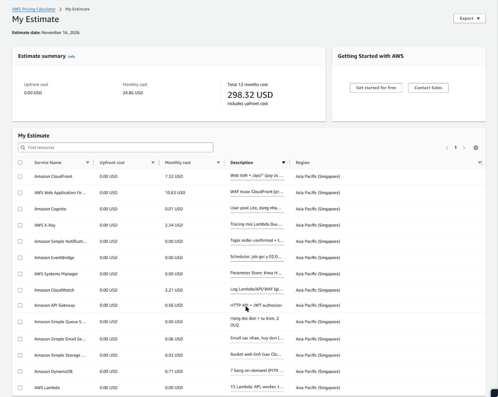

This chapter prepares everything you need before deploying shop-ai: an AWS account, the tools on your machine, the source code, CDK bootstrap, budget alerts and the HMAC key. It ends with the **expected cost**, estimated with AWS Pricing Calculator and compared with the team's real bill.

#### Goals

- Your machine has the right tool versions and can sign in to AWS from the CLI.
- Your AWS account is CDK-bootstrapped in **ap-southeast-1** and has budgets that email you when spending passes a threshold.
- An HMAC key exists in Parameter Store, so recommendations work right after the deploy.
- You know how much this lab costs, and how much a month of real use costs.

---

### 5.2.1. AWS account

- An AWS account. Use a separate account for the lab, not one that runs real workloads.
- An IAM user or role with administrator access (`AdministratorAccess`). CDK creates IAM roles, CloudFormation stacks, Lambda, DynamoDB, S3, CloudFront, Cognito, SQS and SNS.
- Lab Region: **Asia Pacific (Singapore) `ap-southeast-1`**.

{}
Do not use the root user for the lab, and do not create long-term access keys. Step 5.2.3 signs in with `aws login`, which gives temporary credentials.
{}

### 5.2.2. Install the tools

| Tool | Version | Check |
|---|---|---|
| Git | any | `git --version` |
| Node.js | **24** (set in the repo's `.nvmrc`) | `node --version` |
| pnpm | **12** (the repo pins `pnpm@12.8.1`) | `pnpm --version` |
| AWS CLI | v2, a version that has `aws login` | `aws --version` |

Install pnpm after Node.js:

```bash
npm install -g pnpm@12
```

You do not need to install AWS CDK separately: the CDK CLI version is pinned in `infra/package.json` and always runs through `pnpm --filter infra exec cdk`. Docker is not needed either: TypeScript Lambdas are bundled with esbuild, and the Python Lambda only needs its files copied.

Get the source code and install dependencies:

```bash
git clone https://github.com/hhieuann/shop-ai.git
cd shop-ai
git checkout develop
pnpm install
```

### 5.2.3. Sign in to AWS from your machine

```bash
aws login
```

The command opens a browser to sign in, then stores temporary credentials for the CLI. They expire after a few hours; when an AWS command says they expired, run `aws login` again.

Check that you are in the right account and set the default Region:

```bash
aws sts get-caller-identity --query Arn --output text
aws configure set region ap-southeast-1
```

### 5.2.4. Bootstrap CDK

CDK needs a `CDKToolkit` stack (a bucket for Lambda code and the deploy roles) in every Region it deploys to. The sandbox only uses **ap-southeast-1**. Run this in PowerShell from the repo root:

```powershell
$acct = aws sts get-caller-identity --query Account --output text; pnpm --filter infra exec cdk bootstrap "aws://$acct/ap-southeast-1"
```

It ends with `Environment aws://…/ap-southeast-1 bootstrapped`. You only do this once per account.

{}
The team's prod environment also has AWS WAF. A web ACL attached to CloudFront must live in **us-east-1**, so the team's account is bootstrapped in both Regions. The lab sandbox has no WAF, so skip us-east-1.
{}

### 5.2.5. Create budget alerts

Create budgets **before** deploying, so a forgotten resource sends you an email.

1. Open **Billing and Cost Management** → **Budgets** → **Create budget**.
2. Choose **Use a template** → **Monthly cost budget**.
3. Set **Budgeted amount** to `5`, enter the email address for alerts, then **Create budget**.
4. Repeat with `10` and `20` if you want several levels.

AWS emails you when actual cost passes 85% and 100% of the amount, and when forecasted cost passes 100%. The team uses exactly these three budgets ($5, $10, $20) on the project account.

### 5.2.6. Create the HMAC key for behaviour data

shop-ai does not store real `userId` values in the events table used for recommendations. A Lambda hashes `userId` with HMAC-SHA256 and a secret key stored in SSM Parameter Store at `/shop/<environment>/events/hmac-key`. The key is **not in CDK** (no secrets in source code), so you create it once by hand before deploying. The sandbox uses the `sbx` environment.

Check whether the key exists:

```bash
aws ssm describe-parameters --region ap-southeast-1 --parameter-filters "Key=Name,Values=/shop/sbx/events/hmac-key" --query "Parameters[].Name" --output text
```

If the output is empty, create a random 32-byte key. The command does not print the key and clears the variable afterwards (PowerShell):

```powershell
$k = [Convert]::ToBase64String([System.Security.Cryptography.RandomNumberGenerator]::GetBytes(32)); aws ssm put-parameter --region ap-southeast-1 --name /shop/sbx/events/hmac-key --type SecureString --value $k --query Version --output text; Remove-Variable k
```

It prints `1` (the first version of the parameter).

{}
**Do not change the key** on a running environment: the same user would hash to a different value and their past behaviour would no longer match. If you skip this step, ordering still works but the purchase event messages end up in a DLQ. Chapter 5.6.5 describes exactly this incident and how to fix it.
{}

---

### 5.2.7. Cost

#### How much does this lab cost?

Close to **$0**. The lab sandbox has no WAF and creates no CloudWatch alarms (the two biggest costs in prod). Every other service is billed per use, and one person's lab traffic fits within the Free Tier. Remember to do chapter 5.7 to delete the resources when you finish.

#### How much does a month of real use cost?

The team built an estimate in **AWS Pricing Calculator** for "a small shop running in prod for one month", using the configuration in the CDK code:

**Estimate link:** https://calculator.aws/#/estimate?id=0798eb584d82c280a557b96fbf3c8fbe695a6ca0



Traffic assumptions:

| Assumption | Value | How |
|---|---|---|
| Visits | 30,000/month | about 1,000 a day |
| API requests | 450,000/month | 15 requests per visit: products, recommendations, cart, events |
| CloudFront requests | 1,050,000/month | 35 requests per visit (API plus static files) |
| Data out from CloudFront | 50 GB/month | about 1.5 MB per visit |
| Orders, emails | 300 orders, 600 emails | confirmation and cancellation emails |
| Signed-in users | 2,000 MAU | |

Result (Singapore, before tax):

| Service | Main configuration | USD/month |
|---|---|---|
| AWS WAF | 1 web ACL, 2 rate-based rules + 3 managed rule groups, 1.05 million requests | 10.63 |
| Amazon CloudFront | 50 GB out to the internet, 1.05 million HTTPS requests | 7.32 |
| Amazon CloudWatch | 1 GB of logs (kept 2 weeks), 10 alarms, 1 dashboard, 5 custom metrics | 3.21 |
| AWS X-Ray | 460,000 traces | 2.34 |
| Amazon DynamoDB | On-demand, 0.2 million writes, 0.9 million reads, PITR | 0.71 |
| Amazon API Gateway | HTTP API, 450,000 requests | 0.56 |
| Amazon SES | 600 emails | 0.06 |
| Amazon S3 | 0.1 GB, 21,000 requests | 0.02 |
| Amazon Cognito | Lite plan, 2,000 MAU | 0.01 |
| AWS Lambda | Arm, 512 MB, 460,000 invocations, 150 ms | 0.00 |
| Amazon SQS, SNS, EventBridge Scheduler, SSM Parameter Store | | 0.00 |
| **Total** | | **24.86** (298.32/year) |

{}
The Calculator **does not subtract** the CloudFront Free Tier (1 TB and 10 million requests a month). At 50 GB and 1.05 million requests, the $7.32 is really $0. So the real cost is about **$17.5/month**, more than half of it WAF. There is no VPC, NAT gateway, EC2, RDS or load balancer, so there are no other fixed costs.
{}

If you build the estimate yourself, watch out for three defaults that distort the result:

- **DynamoDB** defaults to *provisioned capacity* (about $30/month plus $205 upfront). Turn it off and turn on *on-demand capacity*.
- **Cognito** defaults to *Advanced security features* on (about $100/month at 2,000 MAU). shop-ai does not use them; choose *Disabled*.
- **SNS and EventBridge Scheduler** default to "million per month", and the fields do not accept decimals. Change the unit to "per month", then enter 300 and 30.

#### Compared with the real bill

Cost Explorer for the team's account, 01–15/11/2026, covering dev, staging and prod, before credits:

| Service | Real cost |
|---|---|
| AWS WAF | $1.27 (WAF on since 12/11, about $0.33/day, or about $10/month) |
| AWS Cost Explorer | $0.07 (Cost Explorer API calls) |
| Amazon DynamoDB | $0.07 |
| Amazon API Gateway | $0.04 |
| Amazon S3 | $0.02 |
| Amazon SES, CloudFront | under $0.01 |
| Lambda, Cognito, SQS, SNS, CloudWatch, X-Ray | $0 (within the Free Tier) |

The real numbers match the estimate: at demo traffic, **WAF is almost the whole bill**. The serverless services cost close to $0 because they are billed per use. The second item to watch is CloudWatch alarms: the three environments have 13 alarms, counted as 20 metrics (an alarm with metric math counts as 2), which is above the 10 free alarms and costs about $1/month. The team will remove WAF after the submission, following the runbook `docs/runbooks/waf.md`.

---

Preparation is done. Chapter 5.3 deploys the shop-ai infrastructure to your sandbox with CDK.
