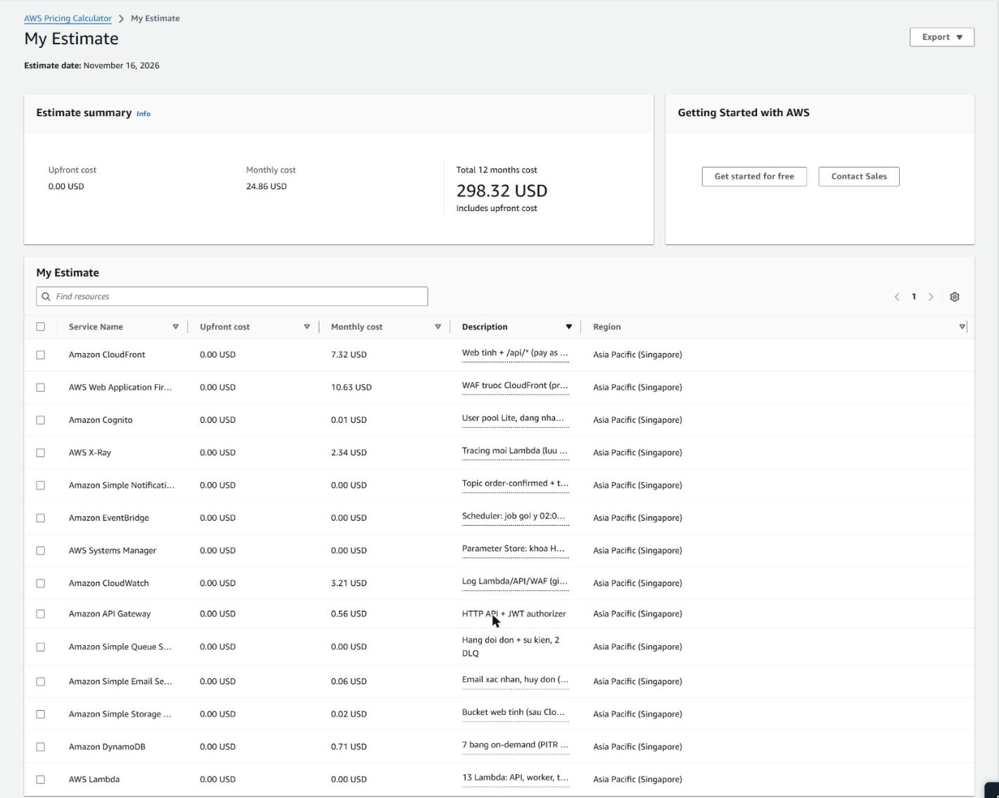

Chương này chuẩn bị mọi thứ trước khi deploy shop-ai: tài khoản AWS, công cụ trên máy, mã nguồn, CDK bootstrap, budget cảnh báo và khoá HMAC. Cuối chương là **chi phí dự kiến**, tính bằng AWS Pricing Calculator và đối chiếu với hoá đơn thật của nhóm.

#### Mục tiêu

- Máy có đủ công cụ, đúng phiên bản, và đăng nhập được vào AWS bằng CLI.
- Tài khoản AWS đã bootstrap CDK ở **ap-southeast-1** và có budget báo khi chi phí vượt ngưỡng.
- Có khoá HMAC trong Parameter Store, để chức năng gợi ý chạy được ngay sau khi deploy.
- Biết lab này tốn bao nhiêu, và chạy thật một tháng thì tốn bao nhiêu.

---

### 5.2.1. Tài khoản AWS

- Một tài khoản AWS. Nên dùng tài khoản riêng cho lab, không dùng chung với hệ thống đang chạy.
- Một IAM user hoặc vai trò có quyền quản trị (`AdministratorAccess`). CDK cần tạo vai trò IAM, stack CloudFormation, Lambda, DynamoDB, S3, CloudFront, Cognito, SQS, SNS.
- Vùng làm lab: **Asia Pacific (Singapore) `ap-southeast-1`**.

{}
Không dùng tài khoản root để làm lab, và không tạo access key dài hạn. Bước 5.2.3 đăng nhập bằng `aws login`, nhận khoá tạm thời.
{}

### 5.2.2. Cài công cụ

| Công cụ | Phiên bản | Kiểm tra |
|---|---|---|
| Git | bất kỳ | `git --version` |
| Node.js | **24** (repo ghi trong `.nvmrc`) | `node --version` |
| pnpm | **12** (repo ghim `pnpm@12.8.1`) | `pnpm --version` |
| AWS CLI | v2, bản có lệnh `aws login` | `aws --version` |

Cài pnpm sau khi đã có Node.js:

```bash
npm install -g pnpm@12
```

Không cần cài AWS CDK riêng: CDK CLI đã ghim phiên bản trong `infra/package.json` và luôn gọi qua `pnpm --filter infra exec cdk`. Cũng không cần Docker, vì Lambda TypeScript được đóng gói bằng esbuild và Lambda Python chỉ cần chép file.

Lấy mã nguồn và cài thư viện:

```bash
git clone https://github.com/hhieuann/shop-ai.git
cd shop-ai
git checkout develop
pnpm install
```

### 5.2.3. Đăng nhập AWS từ máy

```bash
aws login
```

Lệnh mở trình duyệt để đăng nhập, rồi lưu khoá tạm thời cho CLI. Khoá hết hạn sau vài giờ; khi lệnh AWS báo hết hạn thì chạy lại `aws login`.

Kiểm tra đã đăng nhập đúng tài khoản và đặt vùng mặc định:

```bash
aws sts get-caller-identity --query Arn --output text
aws configure set region ap-southeast-1
```

### 5.2.4. Bootstrap CDK

CDK cần một stack `CDKToolkit` (bucket chứa mã Lambda, các vai trò deploy) ở mỗi vùng sẽ deploy. Sandbox chỉ dùng **ap-southeast-1**. Chạy ở thư mục gốc repo, trong PowerShell:

```powershell
$acct = aws sts get-caller-identity --query Account --output text; pnpm --filter infra exec cdk bootstrap "aws://$acct/ap-southeast-1"
```

Khi kết thúc có dòng `Environment aws://…/ap-southeast-1 bootstrapped`. Mỗi tài khoản chỉ cần làm một lần.

{}
Môi trường prod của nhóm có thêm AWS WAF. Web ACL gắn với CloudFront bắt buộc nằm ở **us-east-1**, nên tài khoản của nhóm bootstrap cả 2 vùng. Sandbox trong lab không có WAF nên bỏ qua us-east-1.
{}

### 5.2.5. Tạo budget cảnh báo

Tạo budget **trước** khi deploy, để nếu có tài nguyên quên xoá thì có email báo.

1. Vào **Billing and Cost Management** → **Budgets** → **Create budget**.
2. Chọn **Use a template** → **Monthly cost budget**.
3. Đặt **Budgeted amount** là `5`, điền email nhận cảnh báo, rồi **Create budget**.
4. Lặp lại với `10` và `20` nếu muốn có nhiều mức.

AWS gửi email khi chi phí thật vượt 85% và 100% ngưỡng, và khi chi phí dự báo vượt 100%. Nhóm dùng đúng 3 budget $5, $10, $20 cho tài khoản dự án.

### 5.2.6. Tạo khoá HMAC cho dữ liệu hành vi

shop-ai không lưu `userId` thật trong bảng sự kiện dùng để gợi ý. Lambda băm `userId` bằng HMAC-SHA256 với một khoá bí mật, đặt trong SSM Parameter Store tại `/shop/<môi trường>/events/hmac-key`. Khoá này **không nằm trong CDK** (không để bí mật trong mã nguồn), nên phải tạo bằng tay một lần trước khi deploy. Sandbox dùng môi trường `sbx`.

Kiểm tra khoá đã có chưa:

```bash
aws ssm describe-parameters --region ap-southeast-1 --parameter-filters "Key=Name,Values=/shop/sbx/events/hmac-key" --query "Parameters[].Name" --output text
```

Nếu kết quả trống, tạo khoá ngẫu nhiên 32 byte. Lệnh không in khoá ra màn hình, và xoá biến ngay sau đó (PowerShell):

```powershell
$k = [Convert]::ToBase64String([System.Security.Cryptography.RandomNumberGenerator]::GetBytes(32)); aws ssm put-parameter --region ap-southeast-1 --name /shop/sbx/events/hmac-key --type SecureString --value $k --query Version --output text; Remove-Variable k
```

Kết quả in `1` (phiên bản đầu tiên của tham số).

{}
**Không đổi khoá** khi môi trường đang chạy: cùng một người dùng sẽ bị băm ra mã khác, lịch sử hành vi cũ không còn khớp. Nếu bỏ qua bước này, đặt hàng vẫn chạy nhưng tin ghi sự kiện mua sẽ rơi vào DLQ. Chương 5.6.5 kể lại đúng sự cố này và cách xử lý.
{}

---

### 5.2.7. Chi phí

#### Lab này tốn bao nhiêu?

Gần như **$0**. Sandbox của lab không có WAF và không tạo CloudWatch alarm (hai khoản tốn tiền nhất ở prod). Các dịch vụ còn lại tính theo lượt dùng, và lưu lượng của một người làm lab nằm gọn trong Free Tier. Nhớ làm chương 5.7 để xoá tài nguyên khi xong.

#### Chạy thật một tháng tốn bao nhiêu?

Nhóm lập bản ước tính trên **AWS Pricing Calculator** cho kịch bản "shop nhỏ chạy thật trên prod, 1 tháng", lấy cấu hình từ code CDK:

**Link bản ước tính:** https://calculator.aws/#/estimate?id=0798eb584d82c280a557b96fbf3c8fbe695a6ca0



Giả định lưu lượng:

| Giả định | Giá trị | Cách ra số |
|---|---|---|
| Lượt truy cập | 30.000/tháng | khoảng 1.000 lượt/ngày |
| Request API | 450.000/tháng | 15 request mỗi lượt: xem hàng, gợi ý, giỏ, sự kiện |
| Request CloudFront | 1.050.000/tháng | 35 request mỗi lượt (API cộng file tĩnh) |
| Dữ liệu ra từ CloudFront | 50 GB/tháng | khoảng 1,5 MB mỗi lượt |
| Đơn hàng, email | 300 đơn, 600 email | email xác nhận và huỷ |
| Người dùng đăng nhập | 2.000 MAU | |

Kết quả (vùng Singapore, chưa có thuế):

| Dịch vụ | Cấu hình chính | USD/tháng |
|---|---|---|
| AWS WAF | 1 web ACL, 2 rule giới hạn tốc độ + 3 nhóm managed rule, 1,05 triệu request | 10,63 |
| Amazon CloudFront | 50 GB ra internet, 1,05 triệu request HTTPS | 7,32 |
| Amazon CloudWatch | 1 GB log (giữ 2 tuần), 10 alarm, 1 dashboard, 5 metric tuỳ chỉnh | 3,21 |
| AWS X-Ray | 460.000 trace | 2,34 |
| Amazon DynamoDB | On-demand, 0,2 triệu ghi, 0,9 triệu đọc, PITR | 0,71 |
| Amazon API Gateway | HTTP API, 450.000 request | 0,56 |
| Amazon SES | 600 email | 0,06 |
| Amazon S3 | 0,1 GB, 21.000 request | 0,02 |
| Amazon Cognito | Gói Lite, 2.000 MAU | 0,01 |
| AWS Lambda | Arm, 512 MB, 460.000 lần gọi, 150 ms | 0,00 |
| Amazon SQS, SNS, EventBridge Scheduler, SSM Parameter Store | | 0,00 |
| **Tổng** | | **24,86** (298,32/năm) |

{}
Calculator **không tự trừ** Free Tier của CloudFront (1 TB và 10 triệu request mỗi tháng). Với 50 GB và 1,05 triệu request, khoản $7,32 thực tế là $0. Vậy chi phí thật khoảng **$17,5/tháng**, trong đó WAF chiếm hơn một nửa. Không có VPC, NAT Gateway, EC2, RDS hay load balancer nên không có khoản phí cố định nào khác.
{}

Khi tự nhập lại trên Calculator, chú ý 3 giá trị mặc định làm sai kết quả:

- **DynamoDB** mặc định bật *provisioned capacity* (khoảng $30/tháng cộng $205 trả trước). Tắt nó, bật *on-demand capacity*.
- **Cognito** mặc định bật *Advanced security features* (khoảng $100/tháng với 2.000 MAU). shop-ai không dùng, chọn *Disabled*.
- **SNS, EventBridge Scheduler** mặc định tính theo "million per month", và ô số không nhận số lẻ. Đổi đơn vị sang "per month" rồi nhập 300, 30.

#### Đối chiếu với hoá đơn thật

Cost Explorer của tài khoản nhóm, 01–15/11/2026, gồm cả dev, staging và prod, chưa trừ credit:

| Dịch vụ | Chi phí thật |
|---|---|
| AWS WAF | $1,27 (WAF bật từ 12/11, khoảng $0,33/ngày, tức khoảng $10/tháng) |
| AWS Cost Explorer | $0,07 (phí gọi API Cost Explorer) |
| Amazon DynamoDB | $0,07 |
| Amazon API Gateway | $0,04 |
| Amazon S3 | $0,02 |
| Amazon SES, CloudFront | dưới $0,01 |
| Lambda, Cognito, SQS, SNS, CloudWatch, X-Ray | $0 (trong Free Tier) |

Số thật khớp với ước tính: với lưu lượng demo, **WAF gần như là toàn bộ chi phí**. Các dịch vụ serverless gần như bằng $0 vì tính tiền theo lượt dùng. Khoản thứ hai đáng chú ý là CloudWatch alarm: 3 môi trường có 13 alarm, tính thành 20 metric (alarm dùng metric math tính 2), vượt 10 alarm miễn phí nên tốn khoảng $1/tháng. Nhóm sẽ gỡ WAF sau khi nộp bài, theo runbook `docs/runbooks/waf.md`.

---

Xong phần chuẩn bị. Chương 5.3 deploy hạ tầng shop-ai lên sandbox bằng CDK.
