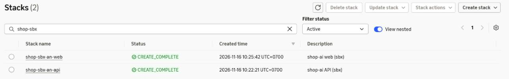
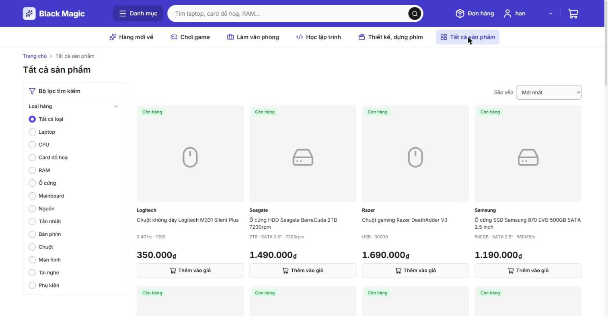

This chapter deploys all of shop-ai to your sandbox with AWS CDK: one command creates the DynamoDB tables, Lambda functions, HTTP API, Cognito, queues, S3 bucket and CloudFront. You then open the web app, sign up, and check the security headers that CloudFront adds. The last two sections are further reading about things that exist only in the team's environments: AWS WAF in prod, and CI/CD with GitHub Actions without access keys.

#### Goals

- Deploy the two stacks `shop-sbx-<name>-api` and `shop-sbx-<name>-web`.
- Open the web app through CloudFront, see the demo products, sign up and sign in.
- Understand how CloudFront splits requests between S3 and API Gateway, and which security headers it adds.

Finish chapter 5.2 first: you have run `aws login`, bootstrapped CDK and created the HMAC key.

---

### 5.3.1. Choose a sandbox name

Everyone has their own sandbox, identified by a short name made of **lowercase letters and digits only** (for example `an`, `hoang`). The name becomes the prefix of every stack: `shop-sbx-<name>-api`, `shop-sbx-<name>-web`. The commands below use `an`; replace it with your own name.

{}
Every CDK command must include `-c env=...`, and a sandbox also needs `-c owner=...`. If either is missing, CDK stops immediately, so nobody deploys to dev, staging or prod by mistake.
{}

### 5.3.2. Build the web app

The web stack uploads `apps/web/dist` to S3, so build it first. From the repo root:

```bash
pnpm --filter web build
```

If you forget, every CDK command stops with a message asking you to run `pnpm --filter web build` before synth or deploy.

### 5.3.3. Preview the changes

```bash
pnpm --filter infra exec cdk diff --all -c env=sbx -c owner=an
```

The command lists every resource that will be created; on the first run every line has `[+]`. Every synth also runs **cdk-nag** against the AWS Solutions rules. If a finding has no recorded justification, synth fails before anything is deployed.

The CDK app has two stacks:

| Stack | Contains | Notes |
|---|---|---|
| `shop-sbx-an-api` | 7 DynamoDB tables, about 13 Lambda functions (Node.js 24, arm64), an HTTP API with a JWT authorizer, a Cognito user pool, SQS and DLQs, SNS, EventBridge Scheduler | A custom resource `SeedProducts` loads **104 demo products** into the `products` table |
| `shop-sbx-an-web` | An S3 bucket (public access blocked), CloudFront with Origin Access Control, a response headers policy, a `config.json` file | Depends on the api stack: it needs the API URL and the user pool IDs |

### 5.3.4. Deploy

```bash
pnpm --filter infra exec cdk deploy --all -c env=sbx -c owner=an
```

CDK shows the IAM permissions it will create and asks `Do you wish to deploy these changes (y/n)?`. Type `y`. The api stack deploys first, then the web stack, about 5 minutes in total; CloudFront alone takes a few minutes to push its configuration to the edge locations.

When it finishes, CDK prints the outputs. The two you need:

```text
Outputs:
shop-sbx-an-api.ApiUrl = https://xxxxxxxxxx.execute-api.ap-southeast-1.amazonaws.com
shop-sbx-an-web.WebUrl = https://dxxxxxxxxxxxxx.cloudfront.net
```

Check in the console: **CloudFormation** → **Stacks**, type `shop-sbx` in the filter. Both stacks must be `CREATE_COMPLETE`.



{}
To see the outputs later: CloudFormation → select the stack → **Outputs** tab. That tab also shows ARNs and queue URLs that contain your account ID, so hide them before sharing a screenshot.
{}

### 5.3.5. Open the web app, sign up and sign in

1. Open `WebUrl` in a browser. The home page shows the categories; **Tất cả sản phẩm** (All products) lists the 104 demo products that were just loaded.

   

2. Click **Đăng ký** (Sign up) and fill in Username, Email, Password (at least 8 characters) and Confirm password. Use an email address you can read: Cognito sends a **verification code** to it.
3. Enter the code, then sign in with the email and password you just created.

The web app has no Cognito settings built in. On load it reads `/config.json` (the web stack creates this file from the api stack's outputs), then talks **directly** to Cognito using SRP: the password never passes through CloudFront or the API. The tokens it receives go with every API request, and API Gateway's **JWT authorizer** checks them before calling a Lambda.

{}
Cognito sends verification emails from the default AWS address, limited to about 50 emails a day per account, which is enough for the lab. Order confirmation emails are sent by SES, which the sandbox turns off (see the note in chapter 5.6.1).
{}

### 5.3.6. CloudFront: one domain for the web app and the API

The CloudFront distribution has three behaviors, matched in order:

| Path | Goes to | Cache |
|---|---|---|
| `/api/v1/products*` | API Gateway | 60 seconds, keyed by query string. The product list is the most called API |
| `/api/*` | API Gateway | None. Cart, orders and events are per-user data |
| default | S3 (through Origin Access Control) | Optimised for static files |

The web app and the API share one domain, so the browser does not need CORS. The S3 bucket blocks all public access; only this distribution can read it, through Origin Access Control.

Check the routing (replace with your `WebUrl`):

```bash
curl -s "https://dxxxxxxxxxxxxx.cloudfront.net/api/v1/products?limit=1"
curl -s -o /dev/null -w "%{http_code}\n" https://dxxxxxxxxxxxxx.cloudfront.net/api/v1/me
```

The first returns JSON with one product. The second returns `401`: `/me` requires sign-in, and the JWT authorizer rejected a request without a token.

### 5.3.7. Security headers

Every response from CloudFront goes through a **response headers policy**. See the real headers with:

```bash
curl -sI https://dxxxxxxxxxxxxx.cloudfront.net/
```

Result on the team's sandbox (16/11/2026), unrelated lines removed:

```text
HTTP/1.1 200 OK
X-Frame-Options: DENY
Referrer-Policy: strict-origin-when-cross-origin
Content-Security-Policy: default-src 'self'; script-src 'self'; style-src 'self'; img-src 'self' data: https:; font-src 'self'; connect-src 'self' https://cognito-idp.ap-southeast-1.amazonaws.com; object-src 'none'; base-uri 'self'; form-action 'self'; frame-ancestors 'none'
X-Content-Type-Options: nosniff
Strict-Transport-Security: max-age=31536000; includeSubDomains
Permissions-Policy: camera=(), microphone=(), geolocation=(), payment=()
```

| Header | Effect |
|---|---|
| `Content-Security-Policy` | The browser only runs scripts and styles from this domain, with no `'unsafe-inline'`, so a script injected into the page (XSS) does not run. `connect-src` allows Cognito because the web app signs in directly with Cognito |
| `Strict-Transport-Security` | The browser uses only HTTPS for this site for one year. CloudFront also redirects `http://` to `https://` |
| `X-Frame-Options: DENY`, `frame-ancestors 'none'` | No site can embed the shop in an iframe, which prevents clickjacking |
| `X-Content-Type-Options: nosniff` | The browser does not guess file types |
| `Referrer-Policy` | Only the domain, not the full path, is sent when a user follows a link to another site |
| `Permissions-Policy` | Turns off camera, microphone, location and payment, which the shop does not use |

Adding these headers cut the OWASP ZAP scan from 12 warnings to 6 (chapter 5.6.6).

---

### 5.3.8. Further reading: AWS WAF in prod

The sandbox, dev and staging have no WAF, to save money (a web ACL costs about $10/month, see 5.2.7). In prod a web ACL is attached to CloudFront with five rules, in order:

| Priority | Rule | What it does |
|---|---|---|
| 10 | `AWSManagedRulesAmazonIpReputationList` | Blocks IPs on AWS's reputation list (bots, known attack sources) |
| 20 | `RateLimitPerIp` | Blocks an IP that sends more than 1,000 requests in 5 minutes |
| 30 | `RateLimitEventsPerIp` | For `/api/v1/events` only: more than 300 requests in 5 minutes is blocked, so nobody can flood fake events to skew recommendations |
| 40 | `AWSManagedRulesCommonRuleSet` | General rules: XSS, path traversal, unusual request sizes |
| 50 | `AWSManagedRulesKnownBadInputsRuleSet` | Known attack patterns such as Log4Shell |

A web ACL for CloudFront must live in **us-east-1**, so WAF is a separate stack (`shop-prd-waf`) in that Region. CDK passes the web ACL ARN to the web stack with `crossRegionReferences`. WAF logs go to CloudWatch Logs, log group `aws-waf-logs-shop-prd`, kept for 14 days.

The common rule set can block legitimate requests, so the team first ran it in **count mode**. From the `v1.0.0-rc.1` deploy (12/11) to 16/11 the logs had 678 requests and 0 blocks. The common rule set counted 74 requests, all of them the team's own XSS test requests; no real request was wrongly matched. From `v1.0.0` the rule set **blocks**.

### 5.3.9. Further reading: CI/CD with GitHub Actions and no access keys

You deploy your sandbox from your own machine. The shared environments (dev, staging, prod) are deployed only by GitHub Actions:

| Event | Environment | Condition |
|---|---|---|
| Merge into `develop` | dev | automatic |
| Push a `release/*` branch | staging | automatic |
| Push a `vX.Y.Z` tag | prod | **another team member must approve** (GitHub environment `production`) |

After each deploy the workflow runs smoke tests, plus end-to-end tests on dev and staging.

GitHub stores **no AWS access keys**. Instead:

1. The job asks GitHub for an **OIDC token** signed for that run only.
2. The job calls `sts:AssumeRoleWithWebIdentity` with the token and gets temporary credentials that last about an hour.
3. The role's trust policy matches the token's `sub` field against the **repository and GitHub environment**. A job in the `dev` environment can only assume `gh-deploy-dev`; to use `gh-deploy-prod` the job must run in the `production` environment, which means someone approved it.
4. A job running on a pull request can only assume `gh-diff-readonly` to run `cdk diff`, with no write access.

The OIDC provider and the four roles are in `infra/bootstrap/github-oidc.yaml`, deployed once per account. One problem worth recording: GitHub repositories created after July 2026 use a new `sub` format that contains immutable IDs of the owner and the repository (`repo:<owner>@<id>/<repo>@<id>:environment:dev`), so a trust policy written for the old format fails with `Not authorized to perform sts:AssumeRoleWithWebIdentity`. The fix came from reading the real `sub` value in the CloudTrail `AssumeRoleWithWebIdentity` event.

---

The infrastructure is running. Chapter 5.4 walks through the sales flow: cart, ordering through SQS and confirmation emails.
