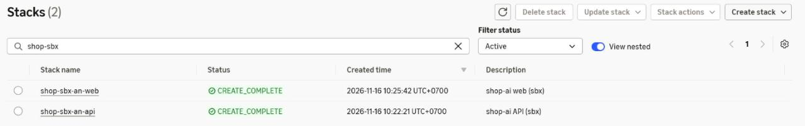
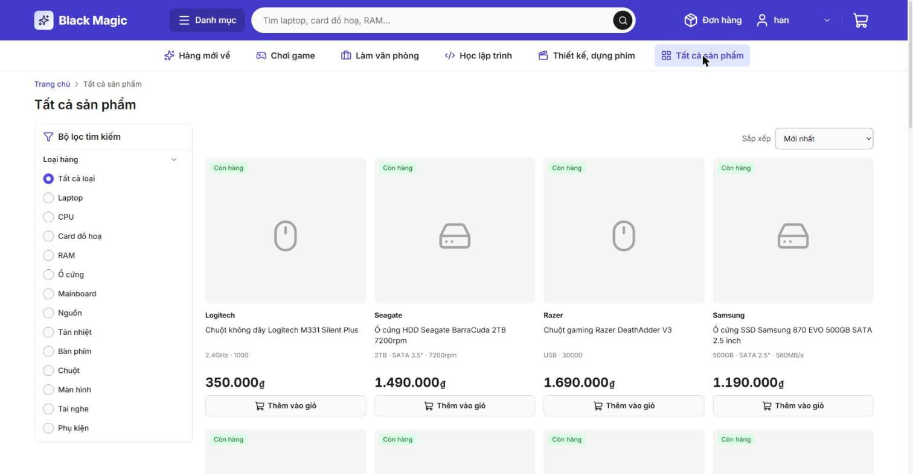

Chương này deploy toàn bộ shop-ai lên sandbox của bạn bằng AWS CDK: một lệnh tạo bảng DynamoDB, Lambda, HTTP API, Cognito, hàng đợi, bucket S3 và CloudFront. Sau đó bạn mở web, đăng ký tài khoản và kiểm tra các header bảo mật do CloudFront thêm vào. Hai mục cuối là phần đọc thêm về những thứ chỉ có ở môi trường của nhóm: AWS WAF ở prod và CI/CD bằng GitHub Actions không dùng access key.

#### Mục tiêu

- Deploy được 2 stack `shop-sbx-<tên>-api` và `shop-sbx-<tên>-web`.
- Mở được web qua CloudFront, có sẵn sản phẩm demo, đăng ký và đăng nhập được.
- Hiểu CloudFront chia request giữa S3 và API Gateway, và thêm những header bảo mật nào.

Làm xong chương 5.2 trước: đã `aws login`, đã bootstrap CDK và đã tạo khoá HMAC.

---

### 5.3.1. Đặt tên sandbox

Mỗi người có sandbox riêng, phân biệt bằng tên ngắn, **chỉ gồm chữ thường và số** (ví dụ `an`, `hoang`). Tên này thành tiền tố của mọi stack: `shop-sbx-<tên>-api`, `shop-sbx-<tên>-web`. Các lệnh dưới đây dùng tên `an`; khi tự làm, thay bằng tên của bạn.

{}
Lệnh CDK nào cũng phải có `-c env=...`, và sandbox cần thêm `-c owner=...`. Thiếu một trong hai thì CDK dừng ngay, để không ai deploy nhầm lên dev, staging hay prod.
{}

### 5.3.2. Build web

Stack web đóng gói thư mục `apps/web/dist` lên S3, nên phải build trước. Chạy ở thư mục gốc repo:

```bash
pnpm --filter web build
```

Nếu quên bước này, mọi lệnh CDK sẽ báo `Chưa có bản build web. Chạy pnpm --filter web build trước khi synth hoặc deploy.`

### 5.3.3. Xem trước thay đổi

```bash
pnpm --filter infra exec cdk diff --all -c env=sbx -c owner=an
```

Lệnh liệt kê mọi tài nguyên sẽ được tạo. Ở lần đầu, mọi dòng đều mang dấu `[+]`. Mỗi lần synth, **cdk-nag** cũng kiểm tra template theo bộ luật AWS Solutions. Nếu còn vi phạm chưa được ghi nhận lý do, synth sẽ thất bại trước khi kịp deploy.

App CDK có 2 stack:

| Stack | Gồm | Ghi chú |
|---|---|---|
| `shop-sbx-an-api` | 7 bảng DynamoDB, khoảng 13 Lambda (Node.js 24, arm64), HTTP API có JWT authorizer, Cognito user pool, SQS và DLQ, SNS, EventBridge Scheduler | Có custom resource `SeedProducts` nạp **104 sản phẩm demo** vào bảng `products` |
| `shop-sbx-an-web` | Bucket S3 (chặn truy cập công khai), CloudFront có Origin Access Control, response headers policy, file `config.json` | Phụ thuộc stack api: cần URL của API và mã user pool |

### 5.3.4. Deploy

```bash
pnpm --filter infra exec cdk deploy --all -c env=sbx -c owner=an
```

CDK hiện danh sách quyền IAM sẽ được tạo rồi hỏi `Do you wish to deploy these changes (y/n)?`. Gõ `y`. Stack api deploy trước, stack web sau, tổng cộng khoảng 5 phút; riêng CloudFront mất vài phút để phân phối cấu hình ra các điểm biên.

Khi xong, CDK in các output. Hai giá trị cần dùng:

```text
Outputs:
shop-sbx-an-api.ApiUrl = https://xxxxxxxxxx.execute-api.ap-southeast-1.amazonaws.com
shop-sbx-an-web.WebUrl = https://dxxxxxxxxxxxxx.cloudfront.net
```

Kiểm tra trên console: **CloudFormation** → **Stacks**, gõ `shop-sbx` vào ô lọc. Cả 2 stack phải ở trạng thái `CREATE_COMPLETE`.



{}
Muốn xem lại output sau này: CloudFormation → chọn stack → tab **Outputs**. Tab này còn có ARN và URL hàng đợi chứa account ID, nên che đi trước khi chụp ảnh chia sẻ.
{}

### 5.3.5. Mở web, đăng ký và đăng nhập

1. Mở `WebUrl` trong trình duyệt. Trang chủ hiện danh mục; vào **Tất cả sản phẩm** sẽ thấy 104 sản phẩm demo vừa được nạp.

   

2. Bấm **Đăng ký**, điền Username, Email, Mật khẩu (ít nhất 8 ký tự) và Nhập lại mật khẩu. Dùng một email bạn đọc được: Cognito gửi **mã xác nhận** tới email đó.
3. Nhập mã xác nhận, rồi đăng nhập bằng email và mật khẩu vừa tạo.

Web không chứa sẵn cấu hình Cognito. Khi tải trang, web đọc `/config.json` (stack web tạo file này từ output của stack api), rồi gọi **thẳng** Cognito bằng giao thức SRP: mật khẩu không bao giờ đi qua CloudFront hay API. Token nhận được gửi kèm mỗi request API, và **JWT authorizer** của API Gateway kiểm token trước khi gọi Lambda.

{}
Cognito gửi email xác nhận bằng địa chỉ mặc định của AWS, giới hạn khoảng 50 email mỗi ngày cho mỗi tài khoản, đủ cho lab. Còn email xác nhận đơn hàng do SES gửi thì sandbox tắt (xem ghi chú ở chương 5.6.1).
{}

### 5.3.6. CloudFront: một tên miền cho cả web và API

Distribution CloudFront có 3 hành vi (behavior), so khớp theo thứ tự:

| Đường dẫn | Đi tới | Cache |
|---|---|---|
| `/api/v1/products*` | API Gateway | 60 giây, theo query string. Trang danh sách sản phẩm là API được gọi nhiều nhất |
| `/api/*` | API Gateway | Không cache. Giỏ hàng, đơn hàng và sự kiện là dữ liệu riêng của từng người |
| mặc định | S3 (qua Origin Access Control) | Cache tối ưu cho file tĩnh |

Nhờ vậy web và API cùng một tên miền, nên trình duyệt không cần CORS. Bucket S3 chặn mọi truy cập công khai: chỉ distribution này đọc được, qua Origin Access Control.

Kiểm tra định tuyến (thay bằng `WebUrl` của bạn):

```bash
curl -s "https://dxxxxxxxxxxxxx.cloudfront.net/api/v1/products?limit=1"
curl -s -o /dev/null -w "%{http_code}\n" https://dxxxxxxxxxxxxx.cloudfront.net/api/v1/me
```

Lệnh đầu trả JSON có 1 sản phẩm. Lệnh sau trả `401`, vì `/me` cần đăng nhập và JWT authorizer đã chặn request không có token.

### 5.3.7. Header bảo mật

Mọi phản hồi từ CloudFront đều đi qua một **response headers policy**. Xem header thật bằng:

```bash
curl -sI https://dxxxxxxxxxxxxx.cloudfront.net/
```

Kết quả trên sandbox của nhóm (16/11/2026), đã bỏ các dòng không liên quan:

```text
HTTP/1.1 200 OK
X-Frame-Options: DENY
Referrer-Policy: strict-origin-when-cross-origin
Content-Security-Policy: default-src 'self'; script-src 'self'; style-src 'self'; img-src 'self' data: https:; font-src 'self'; connect-src 'self' https://cognito-idp.ap-southeast-1.amazonaws.com; object-src 'none'; base-uri 'self'; form-action 'self'; frame-ancestors 'none'
X-Content-Type-Options: nosniff
Strict-Transport-Security: max-age=31536000; includeSubDomains
Permissions-Policy: camera=(), microphone=(), geolocation=(), payment=()
```

| Header | Tác dụng |
|---|---|
| `Content-Security-Policy` | Trình duyệt chỉ chạy script và style từ chính tên miền này, không có `'unsafe-inline'`. Script lạ chèn vào trang (XSS) sẽ không chạy. `connect-src` cho phép gọi Cognito vì web đăng nhập trực tiếp với Cognito |
| `Strict-Transport-Security` | Trình duyệt chỉ dùng HTTPS với trang này trong 1 năm. CloudFront cũng tự chuyển `http://` sang `https://` |
| `X-Frame-Options: DENY`, `frame-ancestors 'none'` | Không trang nào nhúng được shop vào iframe, chống clickjacking |
| `X-Content-Type-Options: nosniff` | Trình duyệt không đoán lại loại file |
| `Referrer-Policy` | Chỉ gửi tên miền, không gửi cả đường dẫn, khi người dùng bấm sang trang khác |
| `Permissions-Policy` | Tắt camera, micro, vị trí, thanh toán, vì shop không dùng |

Thêm bộ header này giúp kết quả quét OWASP ZAP giảm từ 12 xuống 6 cảnh báo (chương 5.6.6).

---

### 5.3.8. Đọc thêm: AWS WAF ở prod

Sandbox và dev, staging không có WAF để tiết kiệm (một web ACL tốn khoảng $10/tháng, xem 5.2.7). Ở prod, web ACL gắn vào CloudFront, có 5 rule theo thứ tự:

| Ưu tiên | Rule | Việc |
|---|---|---|
| 10 | `AWSManagedRulesAmazonIpReputationList` | Chặn IP nằm trong danh sách xấu của AWS (bot, nguồn tấn công đã biết) |
| 20 | `RateLimitPerIp` | Chặn IP gửi quá 1.000 request trong 5 phút |
| 30 | `RateLimitEventsPerIp` | Riêng `/api/v1/events`: quá 300 request trong 5 phút thì chặn, để chống bơm sự kiện giả làm lệch gợi ý |
| 40 | `AWSManagedRulesCommonRuleSet` | Bộ luật chung: XSS, chèn đường dẫn, kích thước request bất thường |
| 50 | `AWSManagedRulesKnownBadInputsRuleSet` | Mẫu tấn công đã biết, ví dụ Log4Shell |

Vì web ACL gắn với CloudFront phải nằm ở **us-east-1**, WAF là một stack riêng (`shop-prd-waf`) ở vùng đó. CDK truyền ARN của web ACL sang stack web bằng `crossRegionReferences`. Log WAF ghi vào CloudWatch Logs, log group `aws-waf-logs-shop-prd`, giữ 14 ngày.

Bộ luật chung dễ chặn nhầm request hợp lệ, nên nhóm bật nó ở **chế độ đếm** (count) trước. Từ khi deploy `v1.0.0-rc.1` (12/11) tới 16/11, log có 678 request, 0 bị chặn. Bộ luật chung đếm 74 request, tất cả đều là request thử XSS của nhóm, không có request thật nào bị khớp nhầm. Vì vậy từ `v1.0.0`, bộ luật này chuyển sang **chặn**.

### 5.3.9. Đọc thêm: CI/CD bằng GitHub Actions, không có access key

Bạn deploy sandbox từ máy mình. Các môi trường chung (dev, staging, prod) thì chỉ GitHub Actions deploy:

| Sự kiện | Môi trường | Điều kiện |
|---|---|---|
| Merge vào `develop` | dev | tự động |
| Push nhánh `release/*` | staging | tự động |
| Push tag `vX.Y.Z` | prod | **một thành viên khác phải duyệt** (GitHub environment `production`) |

Sau mỗi lần deploy, workflow chạy smoke test, rồi test end-to-end ở dev và staging.

GitHub **không lưu access key AWS nào**. Thay vào đó:

1. Job xin GitHub một **token OIDC** ký riêng cho lần chạy đó.
2. Job gọi `sts:AssumeRoleWithWebIdentity` với token này để nhận khoá tạm, có hạn khoảng 1 giờ.
3. Trust policy của role so khớp trường `sub` trong token với **repo và GitHub environment**. Job của môi trường `dev` chỉ assume được `gh-deploy-dev`; muốn dùng `gh-deploy-prod`, job phải chạy trong environment `production`, tức là đã có người duyệt.
4. Job chạy trên pull request chỉ assume được `gh-diff-readonly` để chạy `cdk diff`, không có quyền ghi.

OIDC provider và 4 role nằm trong `infra/bootstrap/github-oidc.yaml`, deploy một lần cho mỗi tài khoản. Trong quá trình làm, nhóm gặp một lỗi đáng ghi lại: repo GitHub tạo sau tháng 7/2026 có trường `sub` dạng mới, chứa mã số bất biến của chủ repo và của repo (`repo:<chủ>@<mã>/<repo>@<mã>:environment:dev`), nên trust policy viết theo dạng cũ báo `Not authorized to perform sts:AssumeRoleWithWebIdentity`. Cách tìm ra: đọc trường `sub` thật trong sự kiện CloudTrail `AssumeRoleWithWebIdentity`.

---

Hạ tầng đã chạy. Chương 5.4 đi qua luồng bán hàng: giỏ hàng, đặt hàng qua SQS và email xác nhận.
