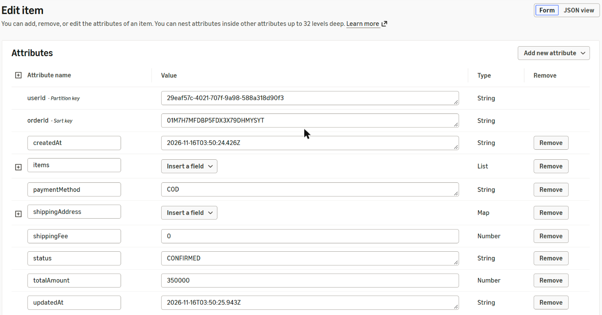
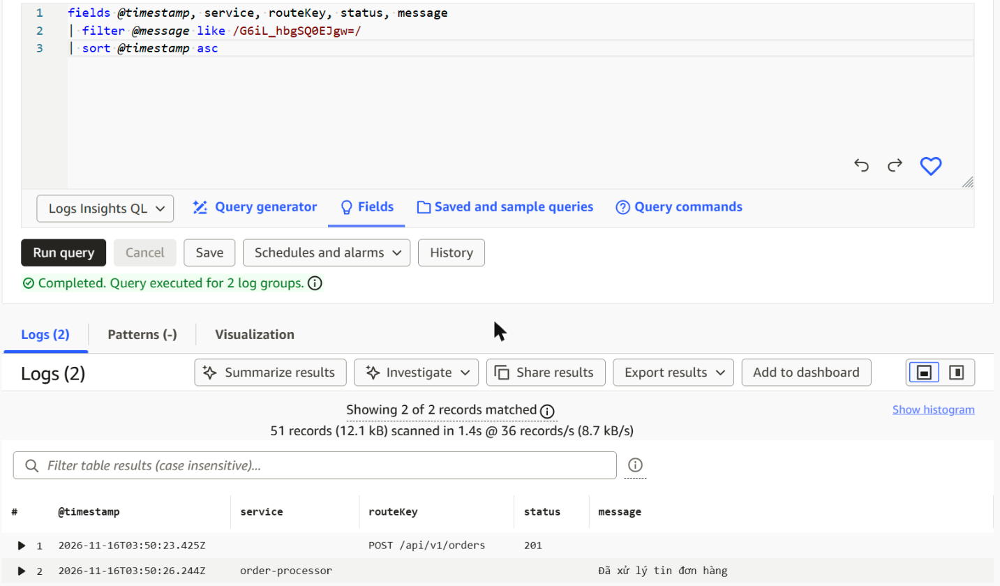
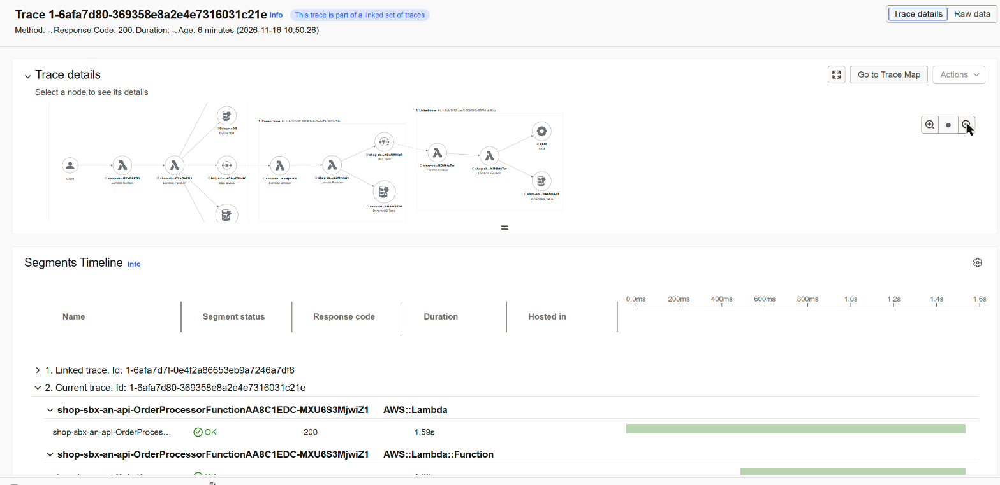

In the previous chapters you deployed shop-ai and placed a test order. This chapter shows how to **look inside the running system**: follow one order through the logs, see the request path in X-Ray, know which alarm fires for which problem, and recover a message stuck in a dead-letter queue (DLQ). It ends with the team's performance, recovery and security-scan numbers.

Everything below runs on your sandbox (`shop-sbx-<name>`) in **ap-southeast-1**.

#### Goals

- Find every log line of an order from a single ID.
- Read an X-Ray trace that goes through API Gateway, Lambda, SQS and DynamoDB.
- Know which alarms exist and which runbook each one points to.
- Move a message from a DLQ back to its source queue after fixing the cause.

---

### 5.6.1. Place an order to get data

1. Open the sandbox web (output `WebUrl` of the `shop-sbx-<name>-web` stack) and sign in.
2. Add 1 product to the cart and place an order with fake data, for example "Khách Test", `0900000000`, "1 Đường Test, Phường Test", TP. Hồ Chí Minh. **Do not cancel** this order.
3. Note the **order ID** shown on the order page (like `01M7H7MF…`) and the time.

Within 1–3 seconds the worker processes the queue message and the order moves from `PENDING` to `CONFIRMED`.

**Check in DynamoDB:** DynamoDB → **Tables** → table `shop-sbx-<name>-api-OrdersTable…` → **Explore table items** → **Scan**, add a filter `orderId` equal to the order ID, then **Run**. The order must have `status = CONFIRMED`; `createdAt` and `updatedAt` are a few seconds apart (the worker's processing time).



{}
The sandbox is deployed without `-c senderEmail=...`, so the worker **does not send** a confirmation email. This is intentional: Amazon SES in sandbox mode can only send to verified addresses.
{}

### 5.6.2. Follow an order with CloudWatch Logs Insights

Every request to API Gateway has a `requestId`. The ordering Lambda copies it into the SQS message as `correlationId`, and the worker logs it. So one ID finds every step of an order, even across different log groups.

1. Find the order's `correlationId`: CloudWatch → **Logs Insights**, select log group `shop-sbx-<name>-api-OrderProcessorLogs…`, a time range around the order time, and run:

   ```text
   fields @timestamp, correlation_id, message
   | filter @message like /<order ID>/
   ```

   The `correlation_id` column is the value you need (for example `G6iL_hbgSQ0EJgw=`).

2. Also select log group `shop-sbx-<name>-api-ApiAccessLogs…` (the API Gateway access log) and run:

   ```text
   fields @timestamp, service, routeKey, status, message
   | filter @message like /G6iL_hbgSQ0EJgw=/
   | sort @timestamp asc
   ```

The result has 2 rows in time order: API Gateway received `POST /api/v1/orders` and returned **201**, then about 3 seconds later the `order-processor` worker logged "Đã xử lý tin đơn hàng" (order message processed).



{}
The query selects only the fields worth reading. With the default `@log, @message`, the result shows the account ID (inside the log group name) and the caller's IP; avoid that when taking screenshots or sharing results.
{}

### 5.6.3. See the request path with AWS X-Ray

Every shop-ai Lambda has X-Ray tracing on and wraps its AWS SDK clients, so each call to DynamoDB, SQS, SNS or SSM becomes a segment in the trace. X-Ray links traces across SQS into a set of **linked traces**.

1. Take the `xray_trace_id` from the worker log (the same line as `correlation_id` in the previous step).
2. CloudWatch → **X-Ray traces** → **Traces**, paste the trace ID into the search box and open the trace.

The map has 3 connected parts:

1. Client → ordering Lambda → DynamoDB (write the order, decrement stock) and SQS (message for the worker).
2. Worker `order-processor` → DynamoDB (order to `CONFIRMED`) and SNS (order confirmed notification).
3. Lambda `events-purchase` receives the SNS message through SQS → SSM (read the HMAC key) and DynamoDB (write the anonymised purchase event used for recommendations).

**Segments Timeline** shows the time of each part; in this run the worker took 1.59 seconds because it was the first cold start.



### 5.6.4. Alarms and runbooks

Alarms exist only in dev, staging and prod (not in sandboxes), because all three environments share one account and the 10 free alarms. Each alarm emails through SNS when it goes to `ALARM` and when it returns to `OK`, and has a runbook in `docs/runbooks/`.

| Alarm | Fires when | Environments | Runbook |
|---|---|---|---|
| `api-5xx` | The API returns 3 or more 5xx errors in 5 minutes | dev, staging, prod | `api-5xx.md` |
| `api-latency-p95` | p95 above 1,000 ms for 3 consecutive 5-minute periods (only periods with at least 20 requests count, so a few cold starts do not fire it) | dev, staging, prod | `api-latency.md` |
| `presignup-errors` | Real errors in the sign-up check Lambda (rejections for a taken or invalid username are subtracted) | dev, staging, prod | `lambda-errors.md` |
| `orders-dlq` | A message is in the order queue's DLQ | prod | `dlq-orders.md` |
| `order-enqueue-failed` | An order was saved but its message could not be sent to the worker | prod | `dlq-orders.md` |
| `lambda-throttles` | Lambda invocations are throttled by the concurrency limit | prod | `lambda-throttle.md` |
| `recs-pipeline-no-success` | The nightly recommendation job had no successful run in 26 hours | prod | `recs-pipeline.md` |

In November 2026 the 13 alarms (prod 7, staging 3, dev 3) used about 20 alarm metrics, because alarms with metric math count as 2, about $1/month above the 10 free alarms. The team keeps the dev and staging alarms to catch problems before prod.

### 5.6.5. A real incident: missing HMAC key, message in the DLQ

The trial run of this lab on a new sandbox (16/11/2026) hit exactly one operational error, and it is a good example of what a DLQ is for.

**Symptom:** placing and cancelling orders works, but the `events-purchase` Lambda logs:

```text
ERROR Không ghi được PURCHASE, SQS sẽ giao lại  {"error": {"name": "ParameterNotFound", ...}}
```

(could not write PURCHASE, SQS will redeliver)

**Cause:** the Lambda hashes `userId` with a key in SSM `/shop/sbx/events/hmac-key`. The key is created with the CLI and is deliberately not in the CDK template (no secrets in source code), so `cdk deploy` does not create it. The new account only had keys for `dev`, `staging` and `prod`.

**What happened:** SQS redelivered the message a few times, failed each time, then moved it to the DLQ `OrderConfirmedEventsDeadLetterQueue`. The message was not lost, only parked.

**Fix:**

1. Create a random key without printing it (this step is now in chapter 5.2):

   ```powershell
   $k = [Convert]::ToBase64String([System.Security.Cryptography.RandomNumberGenerator]::GetBytes(32)); aws ssm put-parameter --region ap-southeast-1 --name /shop/sbx/events/hmac-key --type SecureString --value $k --query Version --output text; Remove-Variable k
   ```

2. Move the DLQ message back: SQS → `shop-sbx-<name>-api-OrderConfirmedEventsDeadLetterQueue…` → **Start DLQ redrive** → **Redrive to source queue**.
3. Check: the `events-purchase` log shows "Đã ghi PURCHASE" (PURCHASE written) and the DLQ has 0 messages.

Lesson: a queue with a DLQ turns a configuration error into **fix, then resend**, with no data lost. In prod, the `orders-dlq` alarm fires as soon as a message lands in the order queue's DLQ.

### 5.6.6. The team's measurements

The team measured before releasing `v1.0.0-rc.1` (09–11/11/2026) against the targets in the plan.

| ID | What | Target | Result |
|---|---|---|---|
| P1 | Lighthouse on mobile, 3 pages (home, list, detail), staging rc.1 build, median of 5 runs | Performance ≥ 90, LCP ≤ 2.5 s, CLS ≤ 0.1, initial JS ≤ 250 KB | Performance **98 / 98 / 94**; median LCP 0.79 / 2.11 / 0.91 s; largest CLS 0.043; JS 131–147 KB |
| P2 | k6 load test (`tests/load/tiers.js`) directly against the staging API Gateway | Reads p95 ≤ 300 ms, orders p95 ≤ 800 ms, errors below 1% | Reads: 50 virtual users p95 **127 ms**, 200 virtual users (about 36 requests/second) p95 **108 ms**; 80 orders placed and cancelled, p95 **269 ms**; 0 errors, no Lambda throttling |
| P3 | Restore drill of the `orders` table with DynamoDB point-in-time recovery | RPO ≤ 5 minutes, RTO ≤ 1 hour | Restored to 5 minutes earlier; new table ACTIVE after **3–10 minutes**; **23 = 23** items. Copying data back to the original table not yet measured |

Automated security checks run every night against staging:

- **OWASP ZAP baseline** (passive scan): 0 FAIL, 6 WARN, 62 PASS after adding security headers in CloudFront (12 WARN before).
- **Schemathesis** generates requests from `contracts/openapi.yaml`: all 2,893 cases passed.
- **WAF in prod**: logs from 12/11 to 16/11 had 678 requests with 0 real requests wrongly matched; the core rule set moves from count to block in `v1.0.0`.

---

Continue to chapter 5.7 to clean up the resources you created.
