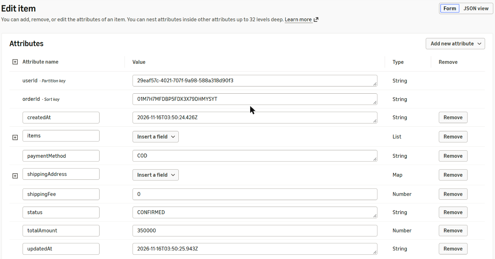
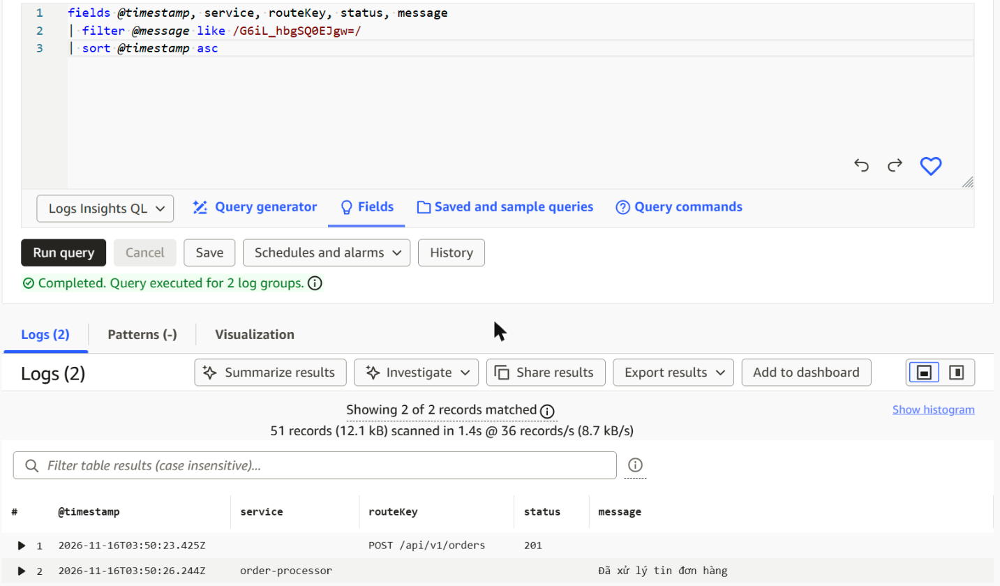
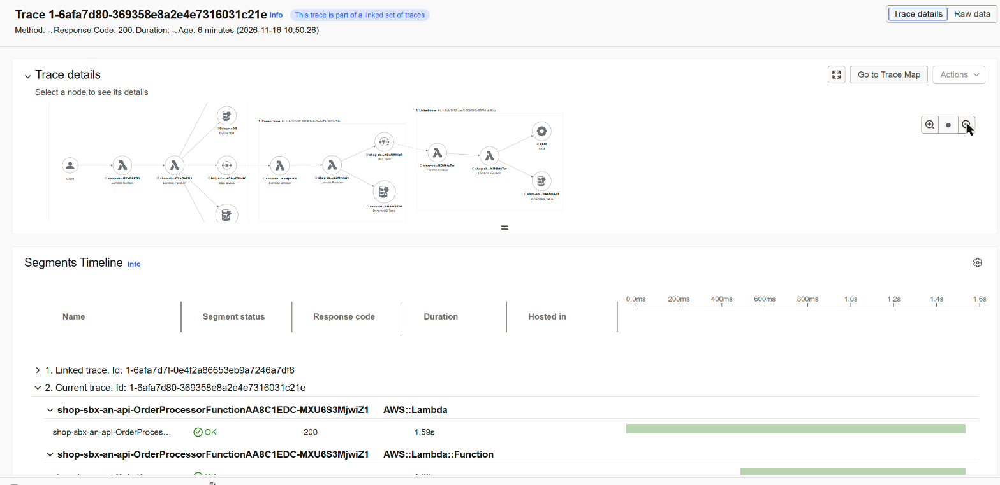

Ở các chương trước bạn đã deploy shop-ai và đặt thử một đơn. Chương này chỉ cách **nhìn vào bên trong hệ thống** khi nó chạy: lần theo một đơn qua log, xem đường đi của request bằng X-Ray, biết alarm nào sẽ báo khi có sự cố, và xử lý một tin nằm trong hàng đợi lỗi (DLQ). Cuối chương là số đo hiệu năng, khả năng khôi phục và kết quả quét bảo mật của nhóm.

Tất cả thao tác dưới đây làm trên sandbox của bạn (`shop-sbx-<tên>`), vùng **ap-southeast-1**.

#### Mục tiêu

- Tìm được mọi dòng log của một đơn hàng chỉ từ một mã.
- Đọc được trace X-Ray đi qua API Gateway, Lambda, SQS và DynamoDB.
- Biết hệ thống có những alarm nào và mỗi alarm dẫn tới runbook nào.
- Chuyển tin trong DLQ về hàng đợi gốc sau khi sửa lỗi.

---

### 5.6.1. Đặt một đơn để có dữ liệu

1. Mở web sandbox (output `WebUrl` của stack `shop-sbx-<tên>-web`), đăng nhập.
2. Thêm 1 sản phẩm vào giỏ, đặt hàng bằng dữ liệu giả, ví dụ "Khách Test", `0900000000`, "1 Đường Test, Phường Test", TP. Hồ Chí Minh. **Không huỷ** đơn này.
3. Ghi lại **mã đơn** hiện trên trang đơn hàng (dạng `01M7H7MF…`) và giờ đặt.

Sau khoảng 1–3 giây, worker xử lý tin trong hàng đợi và đơn chuyển từ `PENDING` sang `CONFIRMED`.

**Kiểm tra trên DynamoDB:** vào DynamoDB → **Tables** → bảng `shop-sbx-<tên>-api-OrdersTable…` → **Explore table items** → **Scan**, thêm bộ lọc `orderId` bằng mã đơn vừa ghi, rồi bấm **Run**. Đơn phải có `status = CONFIRMED`; `createdAt` và `updatedAt` cách nhau vài giây (thời gian worker xử lý).



{}
Sandbox không truyền `-c senderEmail=...` nên worker **không gửi email** xác nhận đơn. Đây là thiết kế có chủ ý: Amazon SES ở chế độ sandbox chỉ gửi được tới địa chỉ đã xác minh.
{}

### 5.6.2. Lần theo một đơn bằng CloudWatch Logs Insights

Mỗi request vào API Gateway có một `requestId`. Lambda đặt hàng chép mã này vào tin gửi SQS thành `correlationId`, worker ghi lại trong log. Nhờ vậy, chỉ cần một mã là tìm được mọi bước của một đơn, dù chúng nằm ở nhiều log group khác nhau.

1. Tìm `correlationId` của đơn: CloudWatch → **Logs Insights**, chọn log group `shop-sbx-<tên>-api-OrderProcessorLogs…`, khung thời gian bao quanh giờ đặt, chạy:

   ```text
   fields @timestamp, correlation_id, message
   | filter @message like /<mã đơn>/
   ```

   Giá trị cột `correlation_id` là mã cần tìm (ví dụ `G6iL_hbgSQ0EJgw=`).

2. Chọn thêm log group `shop-sbx-<tên>-api-ApiAccessLogs…` (log truy cập của API Gateway), thay câu truy vấn:

   ```text
   fields @timestamp, service, routeKey, status, message
   | filter @message like /G6iL_hbgSQ0EJgw=/
   | sort @timestamp asc
   ```

Kết quả có 2 dòng theo thứ tự thời gian: API Gateway nhận `POST /api/v1/orders` và trả **201**, khoảng 3 giây sau worker `order-processor` báo "Đã xử lý tin đơn hàng".



{}
Câu truy vấn chỉ chọn các trường cần đọc. Nếu để mặc định `@log, @message`, kết quả sẽ hiện account ID (trong tên log group) và IP của người gọi; nên tránh khi chụp ảnh hay chia sẻ kết quả.
{}

### 5.6.3. Xem đường đi của request bằng AWS X-Ray

Mọi Lambda của shop-ai bật X-Ray tracing và bọc các client AWS SDK, nên mỗi lần gọi DynamoDB, SQS, SNS, SSM đều thành một đoạn trong trace. X-Ray nối các trace qua SQS thành một **chuỗi trace liên kết** (linked traces).

1. Lấy `xray_trace_id` trong log của worker (cùng dòng với `correlation_id` ở bước trước).
2. CloudWatch → **X-Ray traces** → **Traces**, dán trace ID vào ô tìm kiếm, mở trace.

Sơ đồ có 3 đoạn nối nhau:

1. Client → Lambda đặt hàng → DynamoDB (ghi đơn, trừ kho) và SQS (gửi tin cho worker).
2. Worker `order-processor` → DynamoDB (đơn sang `CONFIRMED`) và SNS (thông báo đơn đã xác nhận).
3. Lambda `events-purchase` nhận tin từ SNS qua SQS → SSM (đọc khoá HMAC) và DynamoDB (ghi sự kiện mua hàng đã ẩn danh cho phần gợi ý).

Phần **Segments Timeline** cho thấy thời gian từng đoạn; trong lần chạy này worker mất 1,59 giây vì là lần khởi động lạnh đầu tiên.



### 5.6.4. Alarm và runbook

Alarm chỉ tạo ở dev, staging, prod (không có ở sandbox), vì cả ba môi trường dùng chung một tài khoản và hạn mức 10 alarm miễn phí. Mỗi alarm gửi email qua SNS khi chuyển sang `ALARM` và khi về lại `OK`, và có một runbook trong `docs/runbooks/` ghi cách xử lý.

| Alarm | Báo khi | Môi trường | Runbook |
|---|---|---|---|
| `api-5xx` | API trả từ 3 lỗi 5xx trong 5 phút | dev, staging, prod | `api-5xx.md` |
| `api-latency-p95` | p95 trên 1.000 ms trong 3 chu kỳ 5 phút liền (chỉ tính chu kỳ có từ 20 request, để vài lần khởi động lạnh không làm alarm kêu) | dev, staging, prod | `api-latency.md` |
| `presignup-errors` | Lambda kiểm tra đăng ký lỗi thật (đã trừ các lần từ chối username trùng hoặc sai luật) | dev, staging, prod | `lambda-errors.md` |
| `orders-dlq` | Có tin trong DLQ của hàng đợi đơn hàng | prod | `dlq-orders.md` |
| `order-enqueue-failed` | Đơn đã ghi nhưng không gửi được tin cho worker | prod | `dlq-orders.md` |
| `lambda-throttles` | Lambda bị giới hạn số lần chạy đồng thời | prod | `lambda-throttle.md` |
| `recs-pipeline-no-success` | Job gợi ý mỗi đêm không chạy thành công lần nào trong 26 giờ | prod | `recs-pipeline.md` |

Tháng 11/2026, 13 alarm (prod 7, staging 3, dev 3) dùng khoảng 20 alarm-metric vì alarm có metric math tính 2, vượt 10 alarm miễn phí khoảng $1/tháng. Nhóm giữ cả alarm ở dev và staging để bắt lỗi trước khi lên prod.

### 5.6.5. Sự cố thật: thiếu khoá HMAC, tin vào DLQ

Lần chạy thử lab này trên một sandbox mới (16/11/2026) gặp đúng một lỗi vận hành, và đó là ví dụ tốt về vai trò của DLQ.

**Triệu chứng:** đặt hàng và huỷ đơn chạy bình thường, nhưng log của Lambda `events-purchase` có:

```text
ERROR Không ghi được PURCHASE, SQS sẽ giao lại  {"error": {"name": "ParameterNotFound", ...}}
```

**Nguyên nhân:** Lambda băm `userId` bằng khoá ở SSM `/shop/sbx/events/hmac-key`. Khoá này tạo bằng CLI, cố ý không nằm trong template CDK (không để bí mật trong mã nguồn), nên `cdk deploy` không tạo. Tài khoản mới chỉ có khoá cho `dev`, `staging`, `prod`.

**Diễn biến:** SQS giao lại tin vài lần, lần nào cũng lỗi, rồi chuyển tin vào DLQ `OrderConfirmedEventsDeadLetterQueue`. Tin không mất, chỉ nằm chờ.

**Cách sửa:**

1. Tạo khoá ngẫu nhiên, không in giá trị ra màn hình (bước này đã có trong chương 5.2):

   ```powershell
   $k = [Convert]::ToBase64String([System.Security.Cryptography.RandomNumberGenerator]::GetBytes(32)); aws ssm put-parameter --region ap-southeast-1 --name /shop/sbx/events/hmac-key --type SecureString --value $k --query Version --output text; Remove-Variable k
   ```

2. Chuyển tin trong DLQ về hàng đợi gốc: SQS → `shop-sbx-<tên>-api-OrderConfirmedEventsDeadLetterQueue…` → **Start DLQ redrive** → chọn **Redrive to source queue**.
3. Kiểm tra: log `events-purchase` có "Đã ghi PURCHASE", DLQ về 0 tin.

Bài học: một hàng đợi có DLQ biến lỗi cấu hình thành việc **sửa rồi gửi lại**, không mất dữ liệu. Ở prod, alarm `orders-dlq` báo ngay khi có tin vào DLQ của hàng đợi đơn hàng.

### 5.6.6. Số đo của nhóm

Nhóm đo trước khi phát hành `v1.0.0-rc.1` (09–11/11/2026) theo các mục tiêu đặt trong kế hoạch.

| Mã | Đo gì | Mục tiêu | Kết quả |
|---|---|---|---|
| P1 | Lighthouse trên điện thoại, 3 trang (trang chủ, danh sách, chi tiết), staging bản rc.1, trung vị 5 lần | Performance ≥ 90, LCP ≤ 2,5 s, CLS ≤ 0,1, JS ban đầu ≤ 250 KB | Performance **98 / 98 / 94**; LCP trung vị 0,79 / 2,11 / 0,91 s; CLS lớn nhất 0,043; JS 131–147 KB |
| P2 | Load test k6 (`tests/load/tiers.js`) bắn thẳng API Gateway staging | Đọc p95 ≤ 300 ms, đặt hàng p95 ≤ 800 ms, lỗi dưới 1% | Đọc: 50 người ảo p95 **127 ms**, 200 người ảo (khoảng 36 request/giây) p95 **108 ms**; đặt rồi huỷ 80 đơn p95 **269 ms**; 0 lỗi, Lambda không bị throttle |
| P3 | Diễn tập khôi phục bảng `orders` bằng DynamoDB point-in-time recovery | RPO ≤ 5 phút, RTO ≤ 1 giờ | Khôi phục về 5 phút trước; bảng mới ACTIVE sau **3–10 phút**; **23 = 23** item. Chưa đo bước chép dữ liệu về bảng cũ |

Kiểm tra bảo mật tự động chạy mỗi đêm vào staging:

- **OWASP ZAP baseline** (quét thụ động): 0 FAIL, 6 WARN, 62 PASS sau khi thêm security headers ở CloudFront (trước đó 12 WARN).
- **Schemathesis** sinh request từ `contracts/openapi.yaml`: 2.893 trường hợp đều đạt.
- **WAF ở prod**: log 12/11–16/11 có 678 request, 0 request thật bị chặn nhầm; core rule set chuyển từ đếm sang chặn từ `v1.0.0`.

---

Sang chương 5.7 để dọn sạch tài nguyên đã tạo.
