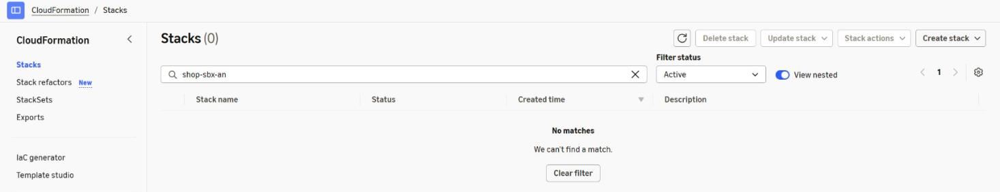
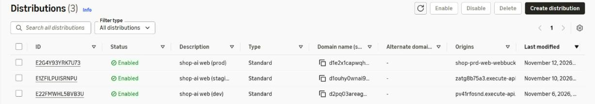

This last chapter deletes everything the lab created, so the account stops costing money. Most of it is one `cdk destroy` command, but a few things live outside the stacks and must be deleted by hand: log groups of the helper Lambdas that CDK generates, the HMAC key in Parameter Store, and the CDK bootstrap stack. The team found these leftovers when trying the lab on a fresh sandbox (16/11/2026).

#### Goals

- Delete the two sandbox stacks and confirm no DynamoDB table, S3 bucket, user pool or distribution remains.
- Delete the resources that live outside CloudFormation.
- Check Billing the next day for any remaining cost.

The commands use the sandbox name `an` as in chapter 5.3; replace it with yours. Run `aws login` first.

---

### 5.7.1. Delete the two sandbox stacks

From the repo root:

```bash
pnpm --filter infra exec cdk destroy --all -c env=sbx -c owner=an
```

CDK asks `Are you sure you want to delete: shop-sbx-an-web, shop-sbx-an-api (y/n)?`. Type `y`. CDK deletes the web stack first (it uses the api stack's outputs), then the api stack. CloudFront is the slowest step: the distribution has to be disabled at every edge location before it can be deleted. On the team's sandbox (16/11/2026) the distribution alone took almost 3 minutes and the whole command about 5 minutes.

The sandbox is set up to delete cleanly, unlike prod:

| Resource | Sandbox, dev, staging | Prod |
|---|---|---|
| DynamoDB tables, Cognito user pool | Deleted with the stack (`RemovalPolicy.DESTROY`) | Kept (`RETAIN`); the user pool has deletion protection |
| Web S3 bucket | Emptied and deleted automatically (`autoDeleteObjects`) | Kept |
| Stacks | Can be deleted right away | Termination protection on |

So for a sandbox, `cdk destroy` also deletes the orders and user accounts you created in the lab.

### 5.7.2. Delete leftover log groups

Every shop-ai Lambda has its log group declared in CDK, so it is deleted with the stack. The **helper Lambdas that CDK generates** (emptying the bucket before deletion, copying the web app to S3) are different: their log groups are created by Lambda on first run, outside CloudFormation, so they are **not deleted**. They look like:

```text
/aws/lambda/shop-sbx-an-api-CustomS3AutoDeleteObjectsCustomRes-...
/aws/lambda/shop-sbx-an-web-CustomS3AutoDeleteObjectsCustomRes-...
/aws/lambda/shop-sbx-an-web-CustomCDKBucketDeployment...
```

When trying the lab, the team found log groups from an 08/10 deploy still there, even though the sandbox had been destroyed and redeployed since. These log groups never expire. They are small and cost almost nothing, but delete them to keep the account clean.

List them:

```bash
aws logs describe-log-groups --region ap-southeast-1 --log-group-name-prefix /aws/lambda/shop-sbx-an- --query "logGroups[].logGroupName" --output text
```

Delete them all (PowerShell):

```powershell
(aws logs describe-log-groups --region ap-southeast-1 --log-group-name-prefix /aws/lambda/shop-sbx-an- --query "logGroups[].logGroupName" --output text) -split "\s+" | Where-Object { $_ } | ForEach-Object { aws logs delete-log-group --region ap-southeast-1 --log-group-name $_; "Deleted $_" }
```

Run the list command again; the output must be empty.

On the team's sandbox, the list command still showed **5 log groups** after `cdk destroy`: 1 from the api stack and 4 from the web stack. Each time a stack is created again, the helper Lambdas get new names (a different random suffix) and write to new log groups, so the more often you deploy and destroy, the more log groups are left behind.

{}
The prefix includes the sandbox name (`shop-sbx-an-`), so the command only deletes this sandbox's log groups. Do not shorten it to `/aws/lambda/shop-`: in an account shared with the team, that would also delete the dev, staging and prod logs.
{}

### 5.7.3. Delete the HMAC key

You created the key by hand in chapter 5.2.6, so `cdk destroy` does not touch it. A standard SecureString parameter is free, but it is an unused secret, so delete it:

```bash
aws ssm delete-parameter --region ap-southeast-1 --name /shop/sbx/events/hmac-key
```

If you deploy the sandbox again later, create a new key first (chapter 5.2.6).

### 5.7.4. Check nothing is left

| Check | Command | Expected |
|---|---|---|
| CloudFormation stacks | `aws cloudformation list-stacks --region ap-southeast-1 --stack-status-filter CREATE_COMPLETE UPDATE_COMPLETE --query "StackSummaries[?starts_with(StackName,'shop-sbx-an')].StackName" --output text` | empty |
| DynamoDB tables | `aws dynamodb list-tables --region ap-southeast-1 --query "TableNames[?starts_with(@,'shop-sbx-an')]" --output text` | empty |
| S3 buckets | `aws s3api list-buckets --query "Buckets[?starts_with(Name,'shop-sbx-an')].Name" --output text` | empty |
| Cognito user pools | `aws cognito-idp list-user-pools --region ap-southeast-1 --max-results 60 --query "UserPools[?starts_with(Name,'shop-sbx-an')].Name" --output text` | empty |
| shop-ai Lambda log groups | `aws logs describe-log-groups --region ap-southeast-1 --log-group-name-prefix shop-sbx-an- --query "logGroups[].logGroupName" --output text` | empty |
| Helper Lambda log groups | the list command in 5.7.2 | empty |

On the team's sandbox, after 5.7.1 to 5.7.3, all six commands returned empty output. Also check in the console:

- **CloudFormation** → **Stacks**, type `shop-sbx-an` in the filter, **Filter status: Active**: no stack is left. Switch to **Deleted** to see the two stacks as `DELETE_COMPLETE`.

  

- **CloudFront** → **Distributions**: no distribution described as `shop-ai web (sbx)`. The three that remain are dev, staging and prod, managed by GitHub Actions and not part of the lab.

  

The old `WebUrl` no longer opens: its `*.cloudfront.net` domain name was deleted with the distribution.

### 5.7.5. Delete the CDK bootstrap (if you no longer use CDK)

The `CDKToolkit` stack from chapter 5.2.4 costs nothing when idle, apart from a few cents for the files in its bucket. If you still plan to use CDK in this account, **keep it**. Otherwise:

1. **S3** → bucket `cdk-hnb659fds-assets-<account>-ap-southeast-1` → **Empty**, type `permanently delete` to confirm. The bucket has versioning on; Empty also removes all old versions.
2. **CloudFormation** → stack `CDKToolkit` → **Delete**.
3. If the bucket is still there after the stack is deleted, go back to S3 and **Delete** it.

{}
If the account is shared with the team (dev, staging, prod), **do not delete** `CDKToolkit`: GitHub Actions needs it to deploy.
{}

### 5.7.6. The next day: check Billing

Billing data lags by about a day, so check the next day:

1. **Billing and Cost Management** → **Cost Explorer**, set the range from the lab day to today, **Group by: Service**.
2. No lab service should show cost after the clean-up day. At one person's lab traffic, the services usually stay within the Free Tier and show $0.
3. Keep the budgets from chapter 5.2.5 for a few more weeks: if anything was left behind, AWS will email you.

---

### 5.7.7. Further reading: cleaning up the team's environments after submission

Prod is protected against accidental deletion (termination protection, tables and bucket set to `RETAIN`), so it is not cleaned up with a single `cdk destroy`. The team has a runbook, `docs/runbooks/waf.md`, section "Dọn sau khi nộp bài" (clean-up after submission), with two options:

- **Option A, remove only WAF** (the team's choice, because graders may still open the site until the internship ends): change the code so prod no longer creates the WAF stack, and deploy prod through the release process so CloudFront no longer has a web ACL. Then turn off termination protection, delete the `shop-prd-waf` stack in us-east-1 and the `aws-waf-logs-shop-prd` log group. WAF is the biggest cost (about $10/month).
- **Option B, remove all of prod**: note the web bucket name, delete the prod web stack and then the WAF stack, then delete the retained web bucket by hand. After this the prod site is gone.

In both options the order matters: the WAF stack cannot be deleted while its web ACL is still attached to the distribution.

---

You have finished the lab: you prepared the account, deployed shop-ai, used it, observed the running system and cleaned everything up.
