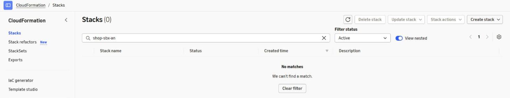
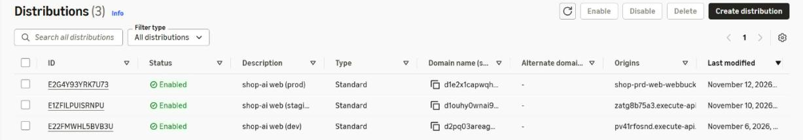

Chương cuối xoá mọi thứ lab đã tạo, để tài khoản không phát sinh chi phí. Phần lớn chỉ cần một lệnh `cdk destroy`, nhưng có vài thứ nằm ngoài stack và phải xoá tay: log group của các Lambda phụ do CDK tạo, khoá HMAC trong Parameter Store, và stack bootstrap CDK. Nhóm phát hiện các thứ còn sót này khi chạy thử lab trên một sandbox mới (16/11/2026).

#### Mục tiêu

- Xoá 2 stack của sandbox và kiểm tra không còn bảng DynamoDB, bucket S3, user pool hay distribution nào.
- Xoá các tài nguyên nằm ngoài CloudFormation.
- Hôm sau kiểm tra Billing không còn chi phí.

Các lệnh dưới đây dùng tên sandbox `an` như chương 5.3; thay bằng tên của bạn. Nhớ `aws login` trước.

---

### 5.7.1. Xoá 2 stack của sandbox

Chạy ở thư mục gốc repo:

```bash
pnpm --filter infra exec cdk destroy --all -c env=sbx -c owner=an
```

CDK hỏi `Are you sure you want to delete: shop-sbx-an-web, shop-sbx-an-api (y/n)?`. Gõ `y`. CDK xoá stack web trước (vì nó dùng output của stack api), rồi tới stack api. Bước chậm nhất là CloudFront: distribution phải được tắt trên mọi điểm biên rồi mới xoá được. Trên sandbox của nhóm (16/11/2026), riêng distribution mất gần 3 phút, cả lệnh khoảng 5 phút.

Sandbox được cấu hình để xoá sạch, khác với prod:

| Tài nguyên | Sandbox, dev, staging | Prod |
|---|---|---|
| Bảng DynamoDB, Cognito user pool | Xoá cùng stack (`RemovalPolicy.DESTROY`) | Giữ lại (`RETAIN`), user pool bật chống xoá |
| Bucket web S3 | Tự làm rỗng rồi xoá (`autoDeleteObjects`) | Giữ lại |
| Stack | Xoá được ngay | Bật termination protection |

Vì vậy với sandbox, `cdk destroy` xoá luôn dữ liệu đơn hàng và tài khoản người dùng đã tạo trong lab.

### 5.7.2. Xoá log group còn sót

Mỗi Lambda của shop-ai có log group khai báo trong CDK, nên bị xoá cùng stack. Riêng các **Lambda phụ do CDK tự sinh** (làm rỗng bucket trước khi xoá, chép web lên S3) thì log group do chính Lambda tạo khi chạy lần đầu, nằm ngoài CloudFormation, nên **không bị xoá**. Chúng có dạng:

```text
/aws/lambda/shop-sbx-an-api-CustomS3AutoDeleteObjectsCustomRes-...
/aws/lambda/shop-sbx-an-web-CustomS3AutoDeleteObjectsCustomRes-...
/aws/lambda/shop-sbx-an-web-CustomCDKBucketDeployment...
```

Khi chạy thử lab, nhóm thấy log group của lần deploy ngày 08/10 vẫn còn, dù sandbox đã bị xoá và deploy lại. Các log group này để "không bao giờ hết hạn". Dung lượng nhỏ nên gần như không tốn tiền, nhưng nên xoá cho sạch tài khoản.

Liệt kê:

```bash
aws logs describe-log-groups --region ap-southeast-1 --log-group-name-prefix /aws/lambda/shop-sbx-an- --query "logGroups[].logGroupName" --output text
```

Xoá hết (PowerShell):

```powershell
(aws logs describe-log-groups --region ap-southeast-1 --log-group-name-prefix /aws/lambda/shop-sbx-an- --query "logGroups[].logGroupName" --output text) -split "\s+" | Where-Object { $_ } | ForEach-Object { aws logs delete-log-group --region ap-southeast-1 --log-group-name $_; "Đã xoá $_" }
```

Chạy lại lệnh liệt kê, kết quả phải trống.

Trên sandbox của nhóm, sau `cdk destroy` lệnh liệt kê vẫn ra **5 log group**: 1 của stack api, 4 của stack web. Mỗi lần tạo lại stack, các Lambda phụ có tên mới (đuôi ngẫu nhiên khác) nên ghi vào log group mới, vì vậy càng deploy rồi xoá nhiều lần thì log group sót lại càng nhiều.

{}
Tiền tố có tên sandbox (`shop-sbx-an-`) nên lệnh chỉ xoá log group của sandbox này. Đừng rút ngắn thành `/aws/lambda/shop-`, vì như vậy sẽ xoá cả log của dev, staging, prod nếu bạn dùng chung tài khoản với nhóm.
{}

### 5.7.3. Xoá khoá HMAC

Khoá được tạo bằng tay ở chương 5.2.6, nên `cdk destroy` không đụng tới. Tham số SecureString loại standard không tốn tiền, nhưng là dữ liệu bí mật không còn dùng nên nên xoá:

```bash
aws ssm delete-parameter --region ap-southeast-1 --name /shop/sbx/events/hmac-key
```

Nếu sau này deploy lại sandbox, nhớ tạo khoá mới trước (chương 5.2.6).

### 5.7.4. Kiểm tra không còn sót

| Kiểm tra | Lệnh | Kết quả mong đợi |
|---|---|---|
| Stack CloudFormation | `aws cloudformation list-stacks --region ap-southeast-1 --stack-status-filter CREATE_COMPLETE UPDATE_COMPLETE --query "StackSummaries[?starts_with(StackName,'shop-sbx-an')].StackName" --output text` | trống |
| Bảng DynamoDB | `aws dynamodb list-tables --region ap-southeast-1 --query "TableNames[?starts_with(@,'shop-sbx-an')]" --output text` | trống |
| Bucket S3 | `aws s3api list-buckets --query "Buckets[?starts_with(Name,'shop-sbx-an')].Name" --output text` | trống |
| Cognito user pool | `aws cognito-idp list-user-pools --region ap-southeast-1 --max-results 60 --query "UserPools[?starts_with(Name,'shop-sbx-an')].Name" --output text` | trống |
| Log group của Lambda shop-ai | `aws logs describe-log-groups --region ap-southeast-1 --log-group-name-prefix shop-sbx-an- --query "logGroups[].logGroupName" --output text` | trống |
| Log group của Lambda phụ | lệnh liệt kê ở 5.7.2 | trống |

Trên sandbox của nhóm, sau khi làm 5.7.1 đến 5.7.3, cả 6 lệnh đều trả về trống. Kiểm tra thêm trên console:

- **CloudFormation** → **Stacks**, gõ `shop-sbx-an` vào ô lọc, **Filter status: Active**: không còn stack nào. Đổi sang **Deleted** sẽ thấy 2 stack ở trạng thái `DELETE_COMPLETE`.

  

- **CloudFront** → **Distributions**: không còn distribution có mô tả `shop-ai web (sbx)`. Ba distribution còn lại là của dev, staging, prod, do GitHub Actions quản lý, không thuộc lab.

  

Mở lại `WebUrl` cũ sẽ không vào được nữa, vì tên miền `*.cloudfront.net` đi cùng distribution đã bị xoá.

### 5.7.5. Xoá bootstrap CDK (nếu không dùng CDK nữa)

Stack `CDKToolkit` ở chương 5.2.4 không tốn tiền khi để không, ngoài vài cent lưu file trong bucket. Nếu bạn còn định dùng CDK trên tài khoản này thì **giữ lại**. Nếu không:

1. **S3** → bucket `cdk-hnb659fds-assets-<account>-ap-southeast-1` → **Empty**, gõ `permanently delete` để xác nhận. Bucket này bật versioning, và nút Empty xoá luôn mọi phiên bản cũ.
2. **CloudFormation** → stack `CDKToolkit` → **Delete**.
3. Nếu sau khi xoá stack, bucket vẫn còn, quay lại S3 và **Delete** bucket.

{}
Nếu tài khoản dùng chung với nhóm (dev, staging, prod), **không xoá** `CDKToolkit`: GitHub Actions cần nó để deploy.
{}

### 5.7.6. Hôm sau: kiểm tra Billing

Chi phí trên Billing cập nhật chậm khoảng một ngày, nên kiểm tra vào hôm sau:

1. **Billing and Cost Management** → **Cost Explorer**, chọn khoảng thời gian từ ngày làm lab tới hôm nay, **Group by: Service**.
2. Không còn dịch vụ nào của lab phát sinh chi phí sau ngày dọn. Với lưu lượng của một người làm lab, các dịch vụ thường nằm trong Free Tier và hiện $0.
3. Giữ các budget ở chương 5.2.5 thêm vài tuần: nếu có gì còn sót, AWS sẽ gửi email.

---

### 5.7.7. Đọc thêm: dọn môi trường của nhóm sau khi nộp bài

Prod được cấu hình chống xoá nhầm (termination protection, bảng và bucket để `RETAIN`), nên không dọn bằng một lệnh `cdk destroy`. Nhóm có runbook riêng `docs/runbooks/waf.md`, mục "Dọn sau khi nộp bài", với 2 cách:

- **Cách A, chỉ gỡ WAF** (nhóm chọn cách này, vì người chấm có thể còn vào web tới hết đợt thực tập): sửa code để prod không tạo stack WAF nữa và deploy prod theo quy trình phát hành, để CloudFront không còn gắn web ACL. Sau đó tắt termination protection, xoá stack `shop-prd-waf` ở us-east-1 và log group `aws-waf-logs-shop-prd`. WAF là khoản tốn tiền nhất (khoảng $10/tháng).
- **Cách B, dọn cả prod**: ghi lại tên bucket web, xoá stack web prod rồi stack WAF, sau đó xoá tay bucket web được giữ lại. Sau cách này web prod không còn truy cập được.

Ở cả hai cách, thứ tự là bắt buộc: web ACL còn gắn vào distribution thì không xoá được stack WAF.

---

Bạn đã đi hết lab: chuẩn bị tài khoản, deploy shop-ai, dùng thử, quan sát hệ thống khi chạy và dọn sạch tài nguyên.
